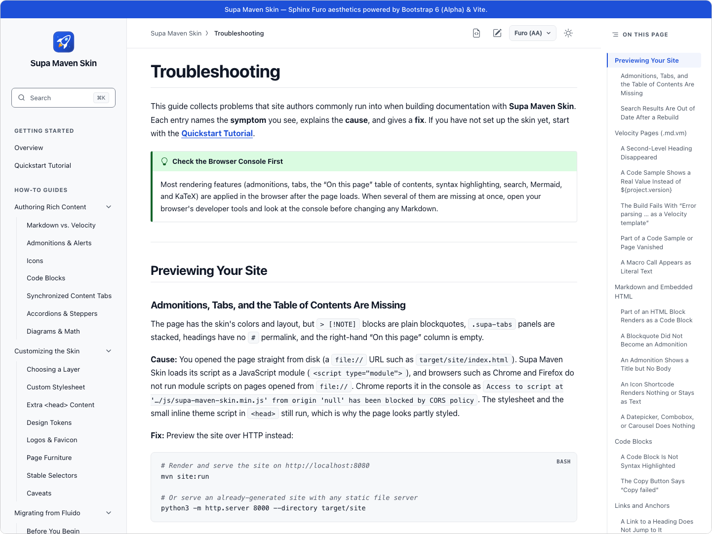
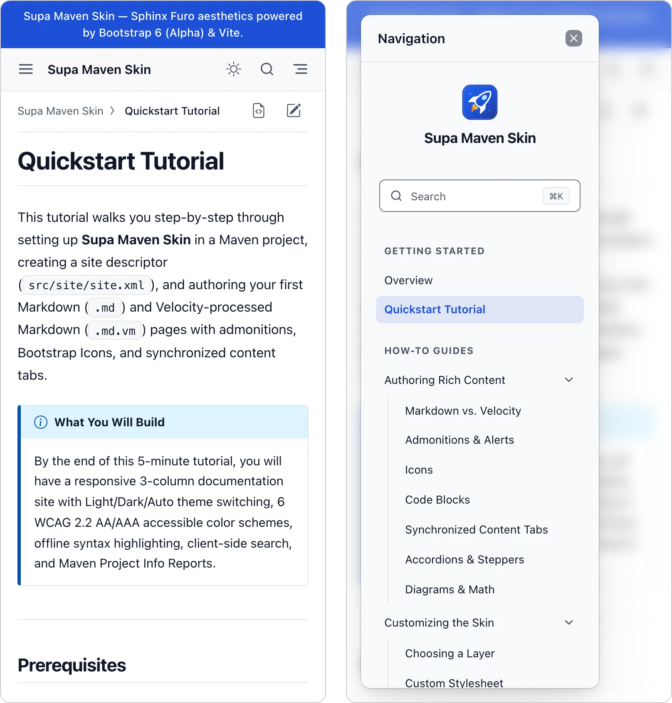
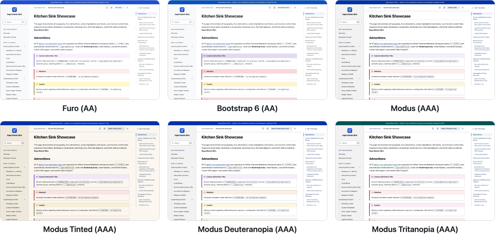

# Supa Maven Skin

[](https://central.sonatype.com/artifact/io.github.mepcotterell/supa-maven-skin)
[](https://github.com/mepcotterell/supa-maven-skin/actions/workflows/ci.yml)
[](LICENSE)

A modern, accessible three-column skin for Maven sites, inspired by [Sphinx Furo](https://github.com/pradyunsg/furo) and built on Bootstrap 6 (`6.0.0-alpha.1`). Add it to `site.xml` and your existing Markdown, APT, and report pages render with it; your build needs no Node.js.

<picture>
  <source media="(prefers-color-scheme: dark)" srcset=".github/screenshots/desktop-dark.webp">
  
</picture>

On a phone, the sidebar and table of contents move into drawers:

<picture>
  <source media="(prefers-color-scheme: dark)" srcset=".github/screenshots/mobile-dark.webp">
  
</picture>

The six color schemes:

<picture>
  <source media="(prefers-color-scheme: dark)" srcset=".github/screenshots/palettes-dark.webp">
  
</picture>

## Features

- Navigation sidebar, article, and "On this page" table of contents, with drawers on small screens.
- Light, dark, and auto themes, and six color schemes checked for WCAG 2.2 AA or AAA contrast.
- Admonitions from `> [!NOTE]`-style blockquotes, synchronized tabs, Bootstrap Icons, and code blocks with copy buttons.
- Built-in search (`/` or `⌘K`).
- Opt-in Mermaid diagrams and KaTeX math, loaded only on pages that use them.
- Clean printouts and PDFs.

## Install

Requires `maven-site-plugin` 3.21.0 or later. Add the skin to `src/site/site.xml`:

```xml
<skin>
  <groupId>io.github.mepcotterell</groupId>
  <artifactId>supa-maven-skin</artifactId>
  <version>0.1.6</version>
</skin>
```

Every other setting is optional; see the [configuration reference](https://mepcotterell.github.io/supa-maven-skin/configuration.html).

## Documentation

The full documentation is at **[mepcotterell.github.io/supa-maven-skin](https://mepcotterell.github.io/supa-maven-skin/)**. Good places to start:

- [Getting Started](https://mepcotterell.github.io/supa-maven-skin/getting-started.html)
- [Configuration](https://mepcotterell.github.io/supa-maven-skin/configuration.html)
- [Migrating from Fluido](https://mepcotterell.github.io/supa-maven-skin/migrating-from-fluido.html)
- [Troubleshooting](https://mepcotterell.github.io/supa-maven-skin/troubleshooting.html)

## Contributing

See [CONTRIBUTING.md](CONTRIBUTING.md) for how to build and test the skin.

## License

MIT License. See [LICENSE](LICENSE).
