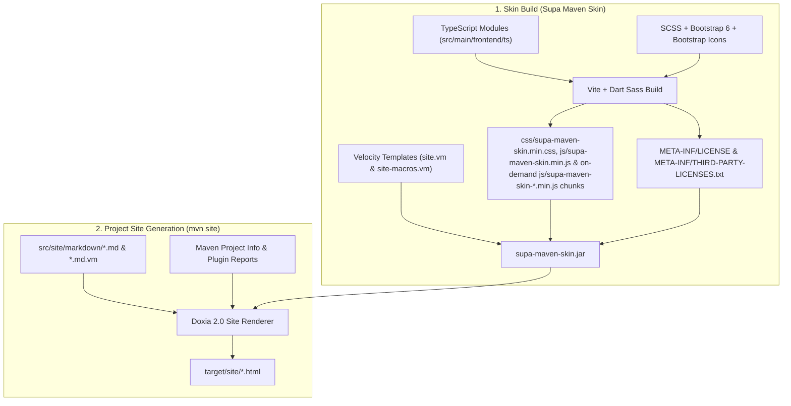

# Architecture & Color System

This page explains how **Supa Maven Skin** bridges Apache Maven's Doxia 2.0 rendering pipeline with **Bootstrap 6 (`6.0.0-alpha.1`)**, Sphinx Furo's 3-column information architecture, and **WCAG 2.2 AA & AAA** accessible color schemes.

---

## Build & Rendering Pipeline

When a Maven project runs `mvn site`, `maven-site-plugin` (`3.21.0+`) and `doxia-site-renderer` (`2.0+`) combine your Markdown/APT/XDoc content and Maven Reports with the skin's pre-bundled assets:

### On-Demand Widget Chunks

`js/supa-maven-skin.min.js` is a single ES module that every page loads. It holds everything the skin's own chrome needs: the theme engine, Doxia normalization, Highlight.js, search, the TOC, and the Bootstrap 6 plugins behind the header menus, tooltips, drawers, search dialog, and ScrollSpy, plus the small data-API plugins (`Alert`, `Button`, `Collapse`, `Popover`, `Toast`, `Toggler`) that cost a few hundred bytes each. The widgets that only author content uses ship as separate chunks beside it, and `bootstrap-components.ts` imports each one with `import()` only when the page contains its markup (`LAZY_WIDGETS`):

| Chunk (`js/supa-maven-skin-<name>.min.js`) | Loads when the page contains |
| :--- | :--- |
| `datepicker` (with its `vanilla-calendar-pro` peer dependency) | `[data-bs-toggle="datepicker"]` |
| `combobox` | `[data-bs-toggle="combobox"]` |
| `chips` | `[data-bs-chips]`, `.chip-input` |
| `otp-input` | `[data-bs-otp]`, `.otp` |
| `range` | `.form-range` |
| `strength` | `[data-bs-strength]`, `.strength` |
| `nav-overflow` | `.nav-overflow`, `[data-bs-toggle="nav-overflow"]` |
| `carousel` | `[data-bs-ride="carousel"]`, `[data-bs-autoplay="true"]`, `.carousel` |
| `tab` | `[data-bs-toggle="tab"]` |
| `playground` (the Component Playground) | `.supa-playground`, `[data-supa-playground]` |

Before the split, the single bundle was 100.5 KiB gzip of its 104 KiB budget. The Datepicker and its calendar library alone added about 18.5 KiB of that, highlight.js and its 18 languages about 29 KiB, the Component Playground 2.4 KiB, and each other widget plugin 0.7&ndash;2.7 KiB. Highlight.js stays in the entry because most documentation pages have code blocks, and loading it later would show the code unhighlighted first. Moving the widgets out brought the entry to 68.6 KiB gzip.

The chunks need no configuration and no extra request on pages without those widgets:

- **Resolution.** `import()` resolves against the importing module's own URL, so the chunks load from `js/` beside the entry on pages at any directory depth. Their names are unhashed, like the skin's other assets, because the JAR is versioned as a whole.
- **One copy of shared code.** Each chunk imports what it shares with the skin (Bootstrap's `base-component.js`, the `dom/data.js` instance map that `bootstrap-components.ts` patches to allow one instance per plugin on an element, `Menu`, and the skin's own helpers) from `js/supa-maven-skin.min.js` itself, so the page keeps one instance of each module. A code-splitting group in `vite.config.ts` keeps all of it in the entry, and a guard plugin fails the build if the entry gains a static import or Rolldown splits off a shared chunk that every page would have to fetch as a second script.
- **Failure tolerance.** A chunk that cannot load (offline, not deployed, blocked by a Content Security Policy) logs one console warning, and its markup stays plain HTML: a datepicker is an ordinary text field, a carousel shows its first slide. The rest of the skin is unaffected.
- **Readiness.** `initSupaSkin()` sets `html[data-supa-ready]` only after every widget chunk the page needed has loaded and initialized (or failed), the same way it waits for Mermaid and KaTeX. Each lazily loaded plugin joins `window.bootstrap` when its chunk loads.

### Bundle Size Budget

Every consumer site downloads `css/supa-maven-skin.min.css` and `js/supa-maven-skin.min.js` on every page, and the widget chunks on the pages that use them, so their size is guarded like contrast is. After Vite finishes, `npm run build` runs `scripts/check-bundle-size.ts`, which prints the raw and gzip size of each file and fails when the CSS bundle, the JS entry, or the widget chunks together exceed their gzip budget, or when a script in `js/` falls under no budget. The shared budget for the chunks means weight moved out of the entry into a chunk, or a new chunk, still has to fit. Maven's `vite-build` execution runs `npm run build`, so `mvn verify` fails on a size regression too. The budgets live in the `BUDGETS` constant of that script: each is the gzip size measured with the Node version Maven pins in `pom.xml`, plus about 5% headroom, rounded up to a whole KiB. A change that legitimately grows a bundle raises the budget in the same change and states the new size and its cause in `CHANGELOG.md`.

### Packaged JAR Layout & `META-INF/` License Isolation

Because `doxia-site-renderer` extracts all non-`META-INF/` files from a skin JAR directly into a consumer project's `target/site/` directory, `supa-maven-skin.jar` keeps only runtime web assets (`css/supa-maven-skin.min.css`, `css/fonts/bootstrap-icons.woff2`, `css/fonts/bootstrap-icons.woff`, `js/supa-maven-skin.min.js`, and the `js/supa-maven-skin-*.min.js` widget chunks) at the JAR root. All Velocity templates, Maven descriptors, and license files are packaged under `META-INF/`:

- `META-INF/maven/site.vm`, `META-INF/maven/site-macros.vm`, `META-INF/maven/skin.xml` — Velocity layout, macros, and skin descriptor.
- `META-INF/LICENSE` — The project's own MIT License.
- `META-INF/THIRD-PARTY-LICENSES.txt` & `META-INF/licenses/LICENSE-*.txt` — Bundled upstream license notices for every npm package compiled into the CSS bundle, the JS entry, or a widget chunk: `bootstrap` (MIT), `bootstrap-icons` (MIT), `highlight.js` (BSD-3-Clause), and Bootstrap 6's peer dependencies `vanilla-calendar-pro`, `@floating-ui/dom`, `@floating-ui/core`, and `@floating-ui/utils` (MIT). The list lives in `scripts/bundled-licenses.ts`, and the build fails when any emitted file contains a package it does not list: JS packages are found from the module graph of every chunk and Sass packages from the partials' `@use` specifiers, so a new transitive dependency cannot ship without its notice.
- `/*! ... */` **Bundle Legal Banners** — `css/supa-maven-skin.min.css`, `js/supa-maven-skin.min.js`, and every widget chunk begin with a `/*! ... */` copyright and license attribution header referencing `META-INF/LICENSE`. The stylesheet and the entry name every package the skin bundles; a chunk names only the packages compiled into it (the Datepicker chunk names `bootstrap` and `vanilla-calendar-pro`), each with a pointer to `META-INF/THIRD-PARTY-LICENSES.txt`.

---

## Responsive 3-Column Furo Layout

Inspired by Pradyun Gedam's [Furo](https://pradyunsg.me/furo/) theme for Sphinx and aligned with **Bootstrap 6 Docs** breakpoints and prose widths, **Supa Maven Skin** organizes technical documentation into three distinct spatial zones that adapt across viewports using native HTML5 `<dialog>` drawers:

1. **Left Navigation Sidebar (`256px` on `lg+` / `1024px+`)**:
   - Displays the project brand, dual-theme logo (`<lightLogo>` / `<darkLogo>`), version badge, search trigger (`⌘K` / `/`), and hierarchical `
` / `
` navigation menus.
   - Below `1024px`, the same DOM node (`<dialog id="supaSidebarDrawer" class="lg:drawer drawer-start">`) acts as an accessible off-canvas Bootstrap 6 left drawer without duplicating navigation markup.
   - Menu, breadcrumb, and logo hrefs arrive from `site.xml` relative to the site root. `#supaResolveHref` in `site-macros.vm` prefixes them with Doxia's `$relativePath` (`..` on `guides/install.html`), as Fluido does with `PathTool.calculateLink()`. To find the current page for sidebar highlighting and the Previous / Next cards, the macros compare the site-root-relative href with Doxia's `$currentFileName` (`guides/install.html`), so links, highlighting, and the cards all work at any directory depth.
2. **Center Article Prose (`56rem` / `896px` maximum reading measure)**:
   - Aligns with Bootstrap 6 Docs prose width on desktop (`56rem` max measure with `3rem` horizontal gutters on `xl+`, and a `47.5rem` / `760px` centered container cap below `lg`) while allowing tables and code blocks to scroll horizontally inside `.supa-table-responsive` and `.supa-code-block`.
3. **Right "On this page" Table of Contents (`224px` on `xl+` / `1280px+`)**:
   - Dynamically constructed at runtime from `h2`–`h4` headings inside `<main id="supa-main-content">` and bound to Bootstrap 6's `ScrollSpy` plugin. An entry whose heading text is in another language than the page, such as `<h4>概要</h4>`, gets the same `lang` (WCAG 2.2 SC 3.1.2).
   - Below `1280px`, `<dialog id="supaTocDrawer" class="xl:drawer drawer-end">` opens as a right-hand drawer from the top utility bar.

---

## Doxia 2.0 Normalization & `.prose` Isolation

Maven reports (such as `dependencies.html`, `ci-management.html`, `team.html`, and `plugin-info.html`) emit legacy Doxia HTML patterns (`<table class="bodyTable">`, `<h2>Section Name</h2>`, `<pre><a class="externalLink">`). At page load, **Supa Maven Skin** normalizes these patterns so reports look indistinguishable from hand-authored Markdown pages:

- **Doxia Heading Anchor Reconciliation (`toc.ts`)**:
  - Doxia places `` immediately before or inside headings without setting an `id` on the `<h2>` element itself.
  - `prepareHeadings()` assigns clean URL-friendly slugs (`id="1-actions-buttons"`) while preserving the original Doxia `<a id="...">` anchor and recording `data-doxia-id`, so links to either ID scroll accurately.
  - `slugifyHeading()` keeps the letters, combining marks, and digits of every script (`\p{L}`, `\p{M}`, `\p{N}`), so `Überblick` gets `id="überblick"` and `概要` gets `id="概要"`, and returns the slug in Unicode NFC, so composed and decomposed text give the same ID. It drops emoji (including `ℹ`, which Unicode classes as a letter), their variation selectors, and keycap marks. Slugs of ASCII-only headings are the same as before 0.1.6. Their IDs are too, except that on a page that also has headings with non-ASCII letters, a repeated ASCII heading's `-2` or `-3` suffix can change, because those headings no longer reduce to the same slug. Browsers percent-encode these IDs in URLs (`#%C3%BCberblick`), so the TOC, `hashchange` handling, and the scroll to the URL's heading on page load decode the fragment before they look up the ID. A malformed fragment such as `#100%` is used as written. The `#` permalink copies the percent-encoded URL, which plain-text linkifiers in email and chat keep whole.
  - Doxia rewrites the fragment of a relative link in a Markdown page when it is not a valid Doxia ID: `DoxiaUtils.encodeId` turns `[Überblick](#überblick)` into `href="#a.C3.BCberblick"`, and the percent-encoded `#%C3%BCberblick` into `#a.25C3.25BCberblick`. So that the first form works, `prepareHeadings()` adds an empty `<a id="a.C3.BCberblick">` before each heading whose ID has non-ASCII characters (`doxiaLinkId()` ports `encodeId`), and the TOC and `hashchange` handling treat that ID as an alias of the heading. `src/it/sample-site/verify.bsh` checks Doxia's output for one such link, so a change in Doxia's encoding fails the build.
- **Responsive Table Classification (`doxia.ts`)**:
  - `normalizeDoxiaTables()` upgrades `table.bodyTable` into `.table.table-hover` inside `.supa-table-responsive` and classifies columns into `.supa-table-col-compact` (single-line identifiers/defaults) vs. `.supa-table-col-prose` (multi-sentence descriptions) so inline `<code>` tokens never wrap mid-word.
- **Keyboard-Scrollable Regions, Report Images & Disabled Links (`doxia.ts`)**:
  - `initScrollRegions()` gives `.supa-table-responsive` and `.supa-code-block > pre` a `tabindex="0"` only while they overflow (re-checked on resize), so keyboard users can scroll wide tables and code without adding a tab stop to every short block.
  - `labelReportAvatars()` marks the Team report's Gravatar `` (emitted without `alt`) as decorative, because the adjacent cell already names the member.
  - `markDisabledPageLinks()` restores Bootstrap's `aria-disabled="true"` and `tabindex="-1"` on `.page-item.disabled > .page-link` and `.page-link.disabled`. Doxia's Markdown sink keeps only base attributes (`class`, `href`, `id`) on raw-HTML links and list items, which left a disabled page link in the tab order, announced as an enabled link, and held to the text contrast that WCAG waives for inactive controls.
- **Bare-URL Links (`site.vm`)**:
  - Autolinks and report links whose text is their own URL (`<a class="externalLink" href="https://…">https://…</a>`) get a `data-supa-bare-url` attribute when `site.vm` writes the page body, so the print stylesheet, which prints the URL after an external link, does not print it twice. CSS cannot compare an element's text with an attribute, so the template marks these links with one regular expression over Doxia's output.
- **`.prose` vs. `.not-prose` Isolation (`bootstrap-components.ts`)**:
  - Bootstrap 6's `.prose` class styles article paragraphs, lists, and tables. `isolateBootstrapComponentsFromProse()` automatically adds `.not-prose` to interactive Bootstrap 6 components (`.card`, `.alert`, `.accordion`, `.nav`, `.stepper`, `.chip-input`) so prose list/margin rules never collide with UI widgets.

---

## WCAG 2.2 AA & AAA Accessible Color System

**Supa Maven Skin** ships with 6 color schemes across Light and Dark polarities (12 total theme surfaces), verified at build time by `scripts/lint-scss.ts`:

| Tier | Palettes | Minimum Contrast Guarantees |
| :--- | :--- | :--- |
| **WCAG 2.2 AA** | `furo`, `bootstrap` | &ge; `4.5:1` for every text and link color on every audited surface (primary and secondary backgrounds, admonition title bars and bodies, `.alert.theme-*` callouts, sidebar, TOC, and search-result states, and Bootstrap 6 components with and without a theme, at rest, hovered, and toggled on); &ge; `3.0:1` for interactive UI borders and admonition icons. |
| **WCAG 2.2 AAA** | `modus`, `modus-tinted`, `modus-deuteranopia`, `modus-tritanopia` | &ge; `7.0:1` for every text and link color on every audited surface; &ge; `4.5:1` for interactive UI borders and admonition icons; colorblind-safe semantic palettes for deuteranopia and tritanopia. |

### How the Contrast Audit Works

`scripts/lint-scss.ts` compiles `main.scss` with Dart Sass and hands the CSS to `scripts/contrast-audit.ts`. For each palette and polarity, the audit collects the custom properties that apply to `<html>` the way the browser's cascade does (matching selector, specificity, source order), then resolves `var()`, `light-dark()`, `rgb()`, `oklch()`, relative `oklch(from ...)` colors (which Bootstrap 6 uses to darken button states), and `color-mix()` in OKLCH or sRGB down to sRGB. The resolver reproduces Chromium's rendering, including its rule that a near-neutral color mixed in OKLCH has no hue, so the colors it measures are the colors the page paints.

What it measures is the `SURFACE_AUDITS` list: each surface's background layers, written as the CSS the painting rule uses, and every foreground drawn on it:

| Surface | Background layers (bottom first) | Foregrounds |
| :--- | :--- | :--- |
| Page | `--color-background-primary` | All 11 semantic text and accent tokens (text); `--color-foreground-border` (non-text) |
| Secondary surface | `--color-background-secondary` on the page | All 11 semantic text and accent tokens (text) |
| Admonition title bar (one per kind) | `--supa-admonition-<kind>-bg` on `--color-admonition-background` on the page | Title text `--color-foreground-primary` and title link `--color-brand-content` (text); icon `--supa-admonition-<kind>-accent` (non-text) |
| Admonition body | `--color-admonition-background` on the page | Body text and link (text) |
| `.alert.theme-<name>` (every Bootstrap 6 theme: `primary`, `accent`, `success`, `info`, `warning`, `danger`, `secondary`, `inverse`) | `--<name>-bg-subtle` on the page | Text `--<name>-fg` and link (text) |
| `.alert` without a Bootstrap theme (`[!ALERT:light]`, `[!ALERT:dark]`) | `--bg-1` on the page | Inherited text and link (text) |
| Sidebar link: at rest, hovered, current page | `--color-background-secondary` on the page, under `--color-background-hover` (hovered) or `--supa-nav-active-bg` (current) | `--color-foreground-primary`, `--supa-nav-hover-fg`, `--supa-nav-active-fg` (text) |
| TOC current section | 6% `color-mix(in srgb, ...)` brand tint on the page | `--color-brand-primary` (text) |
| Search result, active or hovered | `--color-background-hover` on the page | Title `--supa-nav-hover-fg`, snippet `--color-foreground-secondary` (text) |
| Search match highlight (`<mark>`), in a result and in the active result | `--supa-search-mark-bg` (a 22% brand tint) on the result's surface | `--supa-search-mark-fg` (text) |
| Item badge (`.supa-search-result-badge`, `.supa-version-badge`) | `--color-background-item` on the sidebar | `--color-foreground-secondary` (text) |
| `.theme-<name>` solid fill (`.btn`, `.badge`, `.avatar`, `.page-link.active`, `.chip.active`, `.card-header`, ...) for every Bootstrap 6 theme | `--<name>-bg` on the page | `--<name>-contrast` (text) |
| `.theme-<name>` outline button toggled on (`.active`, checked `.btn-check`) | `--<name>-bg` darkened with `oklch(from ... calc(l * .9) calc(c * 1.15) h)` | `--<name>-contrast`, darkened the same way (text) |
| `.theme-<name>` outline, text, and link variants | The page | `--<name>-fg` (text) |
| `.theme-<name>` subtle fill (`.btn-subtle`, `.badge-subtle`, `.avatar-subtle`, `.chip`, `.list-group-item`, `.toast-header`, a hovered `.page-link` or `.menu-item`, ...) | `--<name>-bg-subtle` on the page | `--<name>-fg` and `--<name>-fg-emphasis` (text) |
| `.theme-<name>` solid button hovered and toggled on | `--<name>-bg` darkened to `l * .93` (hovered) or `l * .9` (toggled on) by the override in `_bootstrap-supa.scss` | `--<name>-contrast` (text) |
| `.theme-<name>` outline button hovered | `--<name>-bg` darkened to `l * .95` | `--<name>-contrast`, darkened the same way (text) |
| `.theme-<name>` subtle and text buttons, hovered and toggled on | `--<name>-bg-subtle`, mixed half and half with `--<name>-bg-muted` for a hovered subtle button | `--<name>-fg-emphasis` (subtle) or `--<name>-fg` (text), darkened to `l * .95` or `l * .9` in light polarity only (text) |
| `.theme-<name>` link hovered | The page | `--<name>-fg-emphasis` (text) |
| `.theme-<name>` muted fill: hovered `.chip`, `.nav-link`, and `.list-group-item-action` | `--<name>-bg-muted` on the page | `--<name>-fg` (chip) and `--<name>-fg-emphasis` (text) |
| `.theme-<name>` selected chip hovered (`.chip.active:hover`) | `--<name>-bg` on the page, faded as a whole to `--supa-chip-selected-hover-opacity` | `--<name>-contrast`, faded with it (text) |
| Unthemed `.btn`, `.chip`, `.badge`, at rest and hovered, pressed, or toggled on (also `theme-light` and `theme-dark`, which Bootstrap 6 does not define) | `--bg-2` at rest, `--supa-bg-active` when hovered, on the page | `--fg-body` (text) |
| Datepicker calendar, at rest and with a day, month, or year hovered | `--bg-body`, under `--bg-1` when hovered | Days and the header's month and year `--fg-body`; weekday names and the month and year cells `--fg-3`; days outside the shown month `--color-foreground-muted` (text) |
| Datepicker today and selection (a selected day, month, or year, and every day of a selected range, measured opaque: the `datepicker-range-switched` scan guards the opacity) | `--bg-2` (today) or `--primary-bg` (selection) on the calendar | `--fg-1` (today) and `--primary-contrast` (selection) (text) |

The `.theme-<name>` rows mirror Bootstrap 6's component rules and the skin's overrides of them in `_bootstrap-supa.scss`. A pressed (`:active`) button keeps its hover colors, because Bootstrap applies the toggled-on colors only to `.active`, `.show`, and checked `.btn-check` buttons. An element drawn at reduced `opacity` is composited as a group over the surface beneath it, so its fill and its text both fade, as axe measures them.

Bootstrap derives these states by darkening (`oklch(from ... calc(l * .95) ...)`), which raises text contrast on a light fill and lowers it on a dark one, and from `bg-muted` fills that are darker than the subtle fill in light mode. Three fixes keep every state at its target: in dark polarity, hovered and toggled-on text and subtle buttons keep their resting text color; the `modus*` schemes move each theme's `--<name>-bg-muted` halfway from its subtle fill to the page, where text that meets 7:1 on both still does; and Bootstrap's dark `secondary` and `inverse` muted fills, which were lighter than the text drawn on them, step toward the page in every scheme.

The Datepicker calendar is vanilla-calendar-pro drawn by Bootstrap 6's own `[data-vc]` rules, whose `--datepicker-*` tokens read the `--bg-*` and `--fg-*` steps. Bootstrap fades the days outside the shown month to 50% and the days inside a selected range to 80%, which left day numbers at 3.4:1 in `furo` light and 5.3:1 in `modus` dark. Both are buttons that pick a date, so `_bootstrap-supa.scss` keeps them opaque and marks a day outside the month with the muted text of the weekday names. A disabled day fades to 50% instead: Bootstrap marks it only with `--fg-4`, which the skin also sets to the muted text, and a disabled control is exempt from the contrast minimum. The skin also makes the calendar inherit the page's `color-scheme`: Bootstrap gives the calendar its own `light dark`, which followed the operating system rather than the page once a reader switched from `auto` to an explicit theme. Every token resolves on `<html>`, so no color depends on that today, but a `light-dark()` declared on the calendar, and the browser's own colors, would.

Links are audited on every surface because `.supa-article a` paints them all with `--color-brand-content`, including links inside alerts and inside custom admonition titles, which keep their inline markup. Translucent backgrounds, such as the `rgba()` admonition tints of the `furo` and `bootstrap` dark polarities, are alpha-composited over the layer beneath before measuring. An undefined layer counts as transparent, as it does in CSS, which is why `--color-admonition-background` (defined by no built-in palette) still sits in the title bar's stack: a palette that defines it is measured with it.

Dart Sass compiles `[data-supa-palette="furo"]` to `[data-supa-palette=furo]`, so the audit fails when it cannot find a palette's rule instead of silently measuring nothing, and its success line states how many foreground/surface pairs it checked. To cover a new surface, add an entry to `SURFACE_AUDITS`.

### Build-Time Tokens vs. Rendered-Page Checks

Accessibility is verified in two layers that catch different classes of bugs:

| Layer | Command | Runs in | What it proves |
| :--- | :--- | :--- | :--- |
| **Token contrast** | `npm run lint:scss` (`scripts/lint-scss.ts`) | `npm run lint` and `mvn verify` | Every foreground/surface pair in `SURFACE_AUDITS` (`scripts/contrast-audit.ts`) meets its AA/AAA ratio in all 12 palette &times; polarity variants, resolved from the compiled CSS before any HTML exists. |
| **Rendered pages** | `npm run test:a11y` (`scripts/a11y-check.ts`) | CI (JDK 21 leg) and on demand | The HTML that Velocity, Doxia, the CSS bundle, and the TypeScript enhancers actually produce passes axe-core's `wcag2a`, `wcag2aa`, `wcag21a`, `wcag21aa`, and `wcag22aa` rules: landmarks, names, roles, keyboard reachability, link distinguishability, and computed contrast. On the `modus*` palettes it also passes the AAA `color-contrast-enhanced` rule (7:1). |

`npm run test:a11y` serves `target/site/` from an in-process Node server and opens it in headless Chromium (Playwright). It scans every top-level page (docs and `maven-project-info-reports-plugin` reports) in `furo` light and dark at 1440&times;900, `index.html` in all 12 palette &times; polarity variants (seeded through the same `supa-theme` / `supa-palette` `localStorage` keys the `<head>` script reads), and `index.html` at a 390&times;844 phone viewport. Before scanning it waits for `html[data-supa-ready="true"]`, which `initSupaSkin()` sets once every enhancer, including the asynchronous Mermaid/KaTeX loaders and the on-demand widget chunks, has settled. Any violation fails the run with the page, variant, rule ID, impact, target selector, and help URL.

The AA tags check text contrast at 4.5:1 only, so every `modus*` job, page scans and interaction scenarios alike, also runs axe's `color-contrast-enhanced` rule (WCAG 1.4.6, 7:1 for text). It is the only AAA rule enabled. Before scanning, the run reads the palette's `--supa-wcag-level` from the page and fails if it disagrees with the AAA palettes the script lists, so a scan never measures a palette against the wrong target. The extra rule does not measurably lengthen the run (about 50 seconds for all 134 variants, hover, print, Combobox, and Datepicker scenarios included).

Every scan except the scoped ones described below also checks WCAG 2.5.3 Label in Name on each visible color-scheme trigger (`.supa-palette-btn`): its accessible name must contain the scheme name it shows, as "Color scheme: Furo (AA)" contains "Furo (AA)", so a voice-control user can activate it by saying what they see. axe's own `label-content-name-mismatch` rule runs under `wcag21a`, but it drops parenthesized text before comparing, so it passed a trigger that showed "Furo (AA)" and was named "Accessible color scheme: Furo Default (AA)".

Before every scan, the run waits for the page's running CSS transitions to finish, so axe measures settled colors rather than a fade: a search result leaving the active state switches its title color at once while its fill fades, and a scan taken mid-fade measured brand text on the hover fill. Animations are not awaited, since a spinner never ends.

A page scanned right after load shows the skin's chrome closed, so the same run also scans **interaction scenarios**, by default in `furo` light, `furo` dark, and `modus` dark (AAA); a scenario can list its own palette &times; polarity `variants` instead. Each scenario names a page and viewport, drives the page with Playwright locators, the keyboard, and the mouse, and then scans it:

| Scenario | Page and viewport | State scanned |
| :--- | :--- | :--- |
| `search-dialog-empty` | `index.html`, 1440&times;900 | Search dialog opened with Ctrl/Cmd+K, before a query is typed |
| `search-dialog-results` | `index.html`, 1440&times;900 | Search dialog opened from the sidebar button, searching a word that page titles contain (so matches are highlighted in titles and snippets), with the second result active after ArrowDown |
| `sidebar-drawer` | `index.html`, 390&times;844 | Navigation drawer opened from the mobile header, with its native color-scheme `<select>` showing the active scheme |
| `toc-drawer` | `getting-started.html`, 1100&times;900 | "On this page" drawer, below the `xl` breakpoint where the TOC is not inline |
| `palette-menu`, `theme-menu` | `index.html`, 1440&times;900 | Content-header color-scheme and theme menus opened with ArrowDown, first option focused |
| `mobile-header-palette-menu`, `mobile-header-theme-menu` | `index.html`, 820&times;1180 | The same menus in the mobile header (its color-scheme menu shows from 768px up) |
| `drawer-theme-menu` | `index.html`, 390&times;844 | Theme menu in the sidebar drawer's Appearance footer, with the drawer open |
| `copy-button-tooltip` | `index.html`, 1440&times;900 | Code-block copy button focused, its tooltip shown |
| `copy-button-copied` | `index.html`, 1440&times;900 | Copy button after a click, in its "Copied!" state with the "Copied!" tooltip shown (clipboard permission granted) |
| `sidebar-group-expanded` | `index.html`, 1440&times;900 | A sidebar `
` group collapsed and re-expanded from the keyboard |
| `accordion-expanded`, `content-tab-switched` | `components.html`, 1440&times;900 | Second accordion item expanded; second synchronized tab selected with ArrowRight |
| `chip-hovered`, `unthemed-chip-hovered`, `text-button-hovered` | `components.html`, 1440&times;900 | The `.theme-success` chip, a `.chip-input` chip, and the `.btn-text.theme-primary` button under the mouse, in `furo` light and dark, `modus` light and dark, and `modus-tinted` dark |
| `combobox-open` | `components.html`, 1440&times;900 | The Combobox opened with a click, its menu shown. Its script is an [on-demand chunk](#on-demand-widget-chunks), so the scenario also proves the chunk loaded and initialized in a real browser before `data-supa-ready` |
| `datepicker-open` | `components.html`, 1440&times;900, in all 12 palette &times; polarity variants | The Datepicker calendar opened with a click on its field, with a day outside the shown month under the mouse. The calendar draws its own colors through Bootstrap 6's `[data-vc]` rules, hence every variant, and its script is an on-demand chunk like the Combobox's. It opens on the current month, so the page's clock is fixed in the month of the field's date: whatever the day of the run, the scan sees today, the selected day, and days outside the month. The picker was created under the seeded theme, so Bootstrap copied `data-bs-theme` onto the calendar, which the scenario asserts |
| `datepicker-range-switched` | `components.html`, 1440&times;900 | The same calendar without a copied theme, and in states the demo field never shows. Bootstrap copies `data-bs-theme` only from an ancestor the field had when the picker was created, so the scenario re-creates the picker in `auto` mode, as on a page loaded in it, as a range picker with a latest date, then switches to the variant's polarity with the operating system preferring the other and opens it. It asserts the calendar has no `data-bs-theme` and the page's `color-scheme`, and that a disabled day looks unlike an enabled day outside the month, and the scan sees the days inside a selected range |
| `print-index`, `print-kitchen-sink`, `print-index-wide` | `index.html` and `kitchen-sink.html`, 718&times;1047 (an A4 page's printable width); `index.html`, 1440&times;900 | The page printed: print media emulated and every background dropped except on `print-color-adjust: exact` elements, as browsers print by default, so text is measured against white paper and light text from a dark polarity fails. The scenario asserts `<html>` resolves `color-scheme: light`, the page furniture is not rendered, the article spans the page, nothing is fixed or sticky, and no code block or table scrolls its content. |
| `print-index-auto`, `print-kitchen-sink-auto` | `index.html` and `kitchen-sink.html`, 718&times;1047, in `furo` and `modus` dark | The same printed pages after the theme menu's "Auto" option, with the operating system preferring dark: `<html>` then has no `data-bs-theme`, and the dark polarity comes from Bootstrap's `prefers-color-scheme` rule on `:root`, which the print styles must override too. |

Every scenario asserts its state (`dialog[open]`, `aria-expanded="true"`, a visible tooltip, the focused or hovered element, the print layout) after setup and again after the scan, so a broken selector or a state that closed mid-scan fails the run instead of quietly scanning the closed page. The "Copied!" state resets after 1.8 seconds, so that one scenario scans only the code blocks and the "Copied!" tooltip that Bootstrap appends to `<body>`, a hover scenario scans only the hovered component, `datepicker-open` only the calendar and its field, and `datepicker-range-switched` only the calendar; the unchanged rest of the page is covered by the load-time scans.

The sidebar drawer's color-scheme control is a native `<select>` rather than the menu used in the headers: opened from the bottom of the drawer, the floating menu covered all but slivers of the navigation links above it (axe `target-size`, WCAG 2.5.8), so a tap meant to dismiss it could follow a half-hidden link. The browser draws a native picker outside the page, so there is no open state for axe to scan.

The rendered-page check needs a browser, so it is deliberately **not** part of `npm test` or the Maven build: consumer sites and `mvn verify` never download Chromium. Build the self-site first (`mvn -B -ntp clean verify site`), install Chromium once (`npx playwright install chromium`), then run `npm run test:a11y` (append page or scenario names, such as `npm run test:a11y -- team.html` or `npm run test:a11y -- palette-menu`, to narrow the scan while iterating).

### Zero-FOUC Initialization

An inline script in `<head>` reads `localStorage.getItem('supa-theme')` (`light`, `dark`, `auto`) and `localStorage.getItem('supa-palette')` before first paint, setting `data-bs-theme`, `data-supa-resolved-theme`, and `data-supa-palette` on `<html>`. If the user has not chosen a palette and their OS reports `prefers-contrast: more`, the skin automatically escalates to the WCAG AAA `modus` palette.

---

## Pinned, Integrity-Checked Mermaid & KaTeX

Mermaid and KaTeX never ship inside the skin JAR. `optional.ts` loads them from jsDelivr only on pages that contain diagrams or math, and pins each default to an exact release (`mermaid@11.17.2`, `katex@0.16.47`) with a `sha384` Subresource Integrity hash, so a compromised or changed CDN file is refused by the browser instead of executed.

- **Classic builds instead of ES modules**: dynamic `import()` cannot carry an `integrity` value, and both libraries' ESM entry points import further chunks from the CDN that SRI on the entry file would not cover. The defaults therefore use the single-file `mermaid.min.js`, `katex.min.js`, and `contrib/auto-render.min.js` builds through `<script integrity crossorigin="anonymous">`, and `katex.min.css` through `<link integrity>`, so every byte that runs is verified.
- **One source of truth**: the default URLs and hashes live together in `PINNED_ASSETS` in `optional.ts`. `site.vm` emits `data-supa-mermaid-url`, `data-supa-katex-css-url`, and `data-supa-katex-js-url` only when a consumer overrides them, so a URL cannot drift from its hash.
- **Backward-compatible overrides**: before SRI, every override was loaded with `import()`. A custom URL that is recognizably an ES module (`.mjs`, jsDelivr `/+esm`, or `esm.sh`) still is; any other custom URL loads as a classic `<script>`, and if that defines no usable global, the loader retries it with `import()`, so ES modules with a `.js` name keep working. Custom URLs carry no `integrity`, and the pinned defaults never take the `import()` fallback.
- **Globals checked by shape**: browsers expose any element with `id="katex"` or `id="mermaid"` (for example a Doxia `## katex` heading) as a same-named `window` property, so the loader checks for `katex.render` and Mermaid's `initialize`/`run` rather than for the property's presence.
- **Trade-off**: the classic Mermaid build bundles every diagram type (about 730 KB brotli-compressed, cached as immutable by jsDelivr), while the ESM build fetches only the chunks a page needs (about 230 KB across 27 requests for a flowchart). Sites that prefer the smaller unverified download can set `<mermaidCdnUrl>` to `https://cdn.jsdelivr.net/npm/mermaid@11.17.2/dist/mermaid.esm.min.mjs`.

---

## Zero-Config Client-Side Search

When `<search>true</search>` is active, pressing `/` or `⌘K` (`Ctrl+K`) opens `#supaSearchDialog`:

1. **Immediate Local Index**: On open, `collectLocalSearchDocuments()` immediately indexes all sidebar navigation links and the current page's `h1`–`h4` sections.
2. **Cross-Page & Report Indexing**: `fetchSiteIndex()` fetches sibling pages and Maven reports linked in the sidebar, extracts their page titles, `h1`–`h4` section anchors, and prose snippets, and caches the resulting index in `sessionStorage` for instant subsequent queries during the browsing session. `getSearchIndexCacheKey()` names the cache `supa-search-index-<project version> <html lang> <site root URL>`: the version comes from `html[data-supa-project-version]`, so each new version of the documented project starts with a fresh index, and the site root is resolved from the page URL and `html[data-supa-relative-path]`. Index entries store site-root-relative hrefs, computed from that same root, and `toPageHref()` turns them back into links for the page that shows the results, so an index cached on a top-level page still links correctly from a page in a subdirectory, and the reverse. Because the root and language are part of the key, the locales of a multi-locale site (`maven-site-plugin` renders the default locale at the site root and each other locale under `<locale>/`, with the same version on the same origin) and module sites below their parent each keep their own index. Entries store a kind (`page`, `section`, or `nav`) and only the section names the site supplies, such as `site.xml` menu names and page titles; generic section names such as *Site Page* are filled in from the kind when results are ranked and rendered, so a cached index never holds them. Pages outside the site root, such as the parent project linked by `<menu ref="parent"/>`, are stored as absolute URLs and crawled only when they are on the same origin as the current page.
