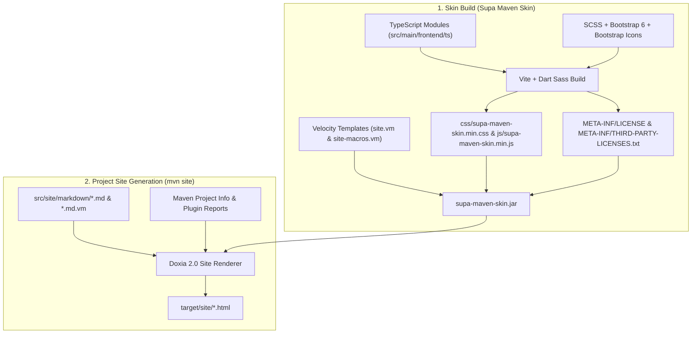

# Architecture & Color System

This page explains how **Supa Maven Skin** bridges Apache Maven's Doxia 2.0 rendering pipeline with **Bootstrap 6 (`6.0.0-alpha.1`)**, Sphinx Furo's 3-column information architecture, and **WCAG 2.2 AA & AAA** accessible color schemes.

---

## Build & Rendering Pipeline

When a Maven project runs `mvn site`, `maven-site-plugin` (`3.21.0+`) and `doxia-site-renderer` (`2.0+`) combine your Markdown/APT/XDoc content and Maven Reports with the skin's pre-bundled assets:

### Bundle Size Budget

Every consumer site downloads `css/supa-maven-skin.min.css` and `js/supa-maven-skin.min.js` on every page, so their size is guarded like contrast is. After Vite finishes, `npm run build` runs `scripts/check-bundle-size.ts`, which prints the raw and gzip size of both bundles and fails when either gzip size exceeds its budget. Maven's `vite-build` execution runs `npm run build`, so `mvn verify` fails on a size regression too. The budgets live in the `BUDGETS` constant of that script: each is the gzip size measured with the Node version Maven pins in `pom.xml`, plus about 5% headroom, rounded up to a whole KiB. A change that legitimately grows a bundle raises the budget in the same change and states the new size and its cause in `CHANGELOG.md`.

### Packaged JAR Layout & `META-INF/` License Isolation

Because `doxia-site-renderer` extracts all non-`META-INF/` files from a skin JAR directly into a consumer project's `target/site/` directory, `supa-maven-skin.jar` keeps only runtime web assets (`css/supa-maven-skin.min.css`, `css/fonts/bootstrap-icons.woff2`, `css/fonts/bootstrap-icons.woff`, and `js/supa-maven-skin.min.js`) at the JAR root. All Velocity templates, Maven descriptors, and license files are packaged under `META-INF/`:

- `META-INF/maven/site.vm`, `META-INF/maven/site-macros.vm`, `META-INF/maven/skin.xml` — Velocity layout, macros, and skin descriptor.
- `META-INF/LICENSE` — The project's own MIT License.
- `META-INF/THIRD-PARTY-LICENSES.txt` & `META-INF/licenses/LICENSE-*.txt` — Bundled upstream license notices for every npm package compiled into the CSS/JS bundles: `bootstrap` (MIT), `bootstrap-icons` (MIT), `highlight.js` (BSD-3-Clause), and Bootstrap 6's peer dependencies `vanilla-calendar-pro`, `@floating-ui/dom`, `@floating-ui/core`, and `@floating-ui/utils` (MIT). The list lives in `scripts/bundled-licenses.ts`, and the build fails when the bundles contain a package it does not list: JS packages are found from the bundler's module graph and Sass packages from the partials' `@use` specifiers, so a new transitive dependency cannot ship without its notice.
- `/*! ... */` **Bundle Legal Banners** — Both `css/supa-maven-skin.min.css` and `js/supa-maven-skin.min.js` begin with a `/*! ... */` copyright and license attribution header referencing `META-INF/LICENSE` and `META-INF/THIRD-PARTY-LICENSES.txt`.

---

## Responsive 3-Column Furo Layout

Inspired by Pradyun Gedam's [Furo](https://pradyunsg.me/furo/) theme for Sphinx and aligned with **Bootstrap 6 Docs** breakpoints and prose widths, **Supa Maven Skin** organizes technical documentation into three distinct spatial zones that adapt across viewports using native HTML5 `<dialog>` drawers:

1. **Left Navigation Sidebar (`256px` on `lg+` / `1024px+`)**:
   - Displays the project brand, dual-theme logo (`<lightLogo>` / `<darkLogo>`), version badge, search trigger (`⌘K` / `/`), and hierarchical `
` / `
` navigation menus.
   - Below `1024px`, the same DOM node (`<dialog id="supaSidebarDrawer" class="lg:drawer drawer-start">`) acts as an accessible off-canvas Bootstrap 6 left drawer without duplicating navigation markup.
2. **Center Article Prose (`56rem` / `896px` maximum reading measure)**:
   - Aligns with Bootstrap 6 Docs prose width on desktop (`56rem` max measure with `3rem` horizontal gutters on `xl+`, and a `47.5rem` / `760px` centered container cap below `lg`) while allowing tables and code blocks to scroll horizontally inside `.supa-table-responsive` and `.supa-code-block`.
3. **Right "On this page" Table of Contents (`224px` on `xl+` / `1280px+`)**:
   - Dynamically constructed at runtime from `h2`–`h4` headings inside `<main id="supa-main-content">` and bound to Bootstrap 6's `ScrollSpy` plugin.
   - Below `1280px`, `<dialog id="supaTocDrawer" class="xl:drawer drawer-end">` opens as a right-hand drawer from the top utility bar.

---

## Doxia 2.0 Normalization & `.prose` Isolation

Maven reports (such as `dependencies.html`, `ci-management.html`, `team.html`, and `plugin-info.html`) emit legacy Doxia HTML patterns (`<table class="bodyTable">`, `<h2>Section Name</h2>`, `<pre><a class="externalLink">`). At page load, **Supa Maven Skin** normalizes these patterns so reports look indistinguishable from hand-authored Markdown pages:

- **Doxia Heading Anchor Reconciliation (`toc.ts`)**:
  - Doxia places `` immediately before or inside headings without setting an `id` on the `<h2>` element itself.
  - `prepareHeadings()` assigns clean URL-friendly slugs (`id="1-actions-buttons"`) while preserving the original Doxia `<a id="...">` anchor and recording `data-doxia-id`, ensuring both Doxia report links and clean Markdown `#slug` links scroll accurately.
- **Responsive Table Classification (`doxia.ts`)**:
  - `normalizeDoxiaTables()` upgrades `table.bodyTable` into `.table.table-hover` inside `.supa-table-responsive` and classifies columns into `.supa-table-col-compact` (single-line identifiers/defaults) vs. `.supa-table-col-prose` (multi-sentence descriptions) so inline `<code>` tokens never wrap mid-word.
- **Keyboard-Scrollable Regions & Report Images (`doxia.ts`)**:
  - `initScrollRegions()` gives `.supa-table-responsive` and `.supa-code-block > pre` a `tabindex="0"` only while they overflow (re-checked on resize), so keyboard users can scroll wide tables and code without adding a tab stop to every short block.
  - `labelReportAvatars()` marks the Team report's Gravatar `` (emitted without `alt`) as decorative, because the adjacent cell already names the member.
- **`.prose` vs. `.not-prose` Isolation (`bootstrap-components.ts`)**:
  - Bootstrap 6's `.prose` class styles article paragraphs, lists, and tables. `isolateBootstrapComponentsFromProse()` automatically adds `.not-prose` to interactive Bootstrap 6 components (`.card`, `.alert`, `.accordion`, `.nav`, `.stepper`, `.chip-input`) so prose list/margin rules never collide with UI widgets.

---

## WCAG 2.2 AA & AAA Accessible Color System

**Supa Maven Skin** ships with 6 color schemes across Light and Dark polarities (12 total theme surfaces), verified at build time by `scripts/lint-scss.ts`:

| Tier | Palettes | Minimum Contrast Guarantees |
| :--- | :--- | :--- |
| **WCAG 2.2 AA** | `furo`, `bootstrap` | &ge; `4.5:1` for body and secondary text against both primary and secondary backgrounds; &ge; `3.0:1` for interactive UI borders. |
| **WCAG 2.2 AAA** | `modus`, `modus-tinted`, `modus-deuteranopia`, `modus-tritanopia` | &ge; `7.0:1` for body, secondary, muted, code, and admonition text against both primary and secondary backgrounds; colorblind-safe semantic palettes for deuteranopia and tritanopia. |

### Build-Time Tokens vs. Rendered-Page Checks

Accessibility is verified in two layers that catch different classes of bugs:

| Layer | Command | Runs in | What it proves |
| :--- | :--- | :--- | :--- |
| **Token contrast** | `npm run lint:scss` (`scripts/lint-scss.ts`) | `npm run lint` and `mvn verify` | Every semantic color pair in `_variables.scss` meets its AA/AAA ratio in all 12 palette &times; polarity variants, before any HTML exists. |
| **Rendered pages** | `npm run test:a11y` (`scripts/a11y-check.ts`) | CI (JDK 21 leg) and on demand | The HTML that Velocity, Doxia, the CSS bundle, and the TypeScript enhancers actually produce passes axe-core's `wcag2a`, `wcag2aa`, `wcag21a`, `wcag21aa`, and `wcag22aa` rules: landmarks, names, roles, keyboard reachability, link distinguishability, and computed contrast. |

`npm run test:a11y` serves `target/site/` from an in-process Node server and opens it in headless Chromium (Playwright). It scans every top-level page (docs and `maven-project-info-reports-plugin` reports) in `furo` light and dark at 1440&times;900, `index.html` in all 12 palette &times; polarity variants (seeded through the same `supa-theme` / `supa-palette` `localStorage` keys the `<head>` script reads), and `index.html` at a 390&times;844 phone viewport. Before scanning it waits for `html[data-supa-ready="true"]`, which `initSupaSkin()` sets once every enhancer, including the asynchronous Mermaid/KaTeX loaders, has settled. Any violation fails the run with the page, variant, rule ID, impact, target selector, and help URL.

The rendered-page check needs a browser, so it is deliberately **not** part of `npm test` or the Maven build: consumer sites and `mvn verify` never download Chromium. Build the self-site first (`mvn -B -ntp clean verify site`), install Chromium once (`npx playwright install chromium`), then run `npm run test:a11y` (append page names, such as `npm run test:a11y -- team.html`, to narrow the scan while iterating).

### Zero-FOUC Initialization

An inline script in `<head>` reads `localStorage.getItem('supa-theme')` (`light`, `dark`, `auto`) and `localStorage.getItem('supa-palette')` before first paint, setting `data-bs-theme`, `data-supa-resolved-theme`, and `data-supa-palette` on `<html>`. If the user has not chosen a palette and their OS reports `prefers-contrast: more`, the skin automatically escalates to the WCAG AAA `modus` palette.

---

## Pinned, Integrity-Checked Mermaid & KaTeX

Mermaid and KaTeX never ship inside the skin JAR. `optional.ts` loads them from jsDelivr only on pages that contain diagrams or math, and pins each default to an exact release (`mermaid@11.17.2`, `katex@0.16.47`) with a `sha384` Subresource Integrity hash, so a compromised or changed CDN file is refused by the browser instead of executed.

- **Classic builds instead of ES modules**: dynamic `import()` cannot carry an `integrity` value, and both libraries' ESM entry points import further chunks from the CDN that SRI on the entry file would not cover. The defaults therefore use the single-file `mermaid.min.js`, `katex.min.js`, and `contrib/auto-render.min.js` builds through `<script integrity crossorigin="anonymous">`, and `katex.min.css` through `<link integrity>`, so every byte that runs is verified.
- **One source of truth**: the default URLs and hashes live together in `PINNED_ASSETS` in `optional.ts`. `site.vm` emits `data-supa-mermaid-url`, `data-supa-katex-css-url`, and `data-supa-katex-js-url` only when a consumer overrides them, so a URL cannot drift from its hash.
- **Backward-compatible overrides**: before SRI, every override was loaded with `import()`. A custom URL that is recognizably an ES module (`.mjs`, jsDelivr `/+esm`, or `esm.sh`) still is; any other custom URL loads as a classic `<script>`, and if that defines no usable global, the loader retries it with `import()`, so ES modules with a `.js` name keep working. Custom URLs carry no `integrity`, and the pinned defaults never take the `import()` fallback.
- **Globals checked by shape**: browsers expose any element with `id="katex"` or `id="mermaid"` (for example a Doxia `## katex` heading) as a same-named `window` property, so the loader checks for `katex.render` and Mermaid's `initialize`/`run` rather than for the property's presence.
- **Trade-off**: the classic Mermaid build bundles every diagram type (about 730 KB brotli-compressed, cached as immutable by jsDelivr), while the ESM build fetches only the chunks a page needs (about 230 KB across 27 requests for a flowchart). Sites that prefer the smaller unverified download can set `<mermaidCdnUrl>` to `https://cdn.jsdelivr.net/npm/mermaid@11.17.2/dist/mermaid.esm.min.mjs`.

---

## Zero-Config Client-Side Search

When `<search>true</search>` is active, pressing `/` or `⌘K` (`Ctrl+K`) opens `#supaSearchDialog`:

1. **Immediate Local Index**: On open, `collectLocalSearchDocuments()` immediately indexes all sidebar navigation links and the current page's `h1`–`h4` sections.
2. **Cross-Page & Report Indexing**: `fetchSiteIndex()` fetches sibling pages and Maven reports linked in the sidebar, extracts their page titles, `h1`–`h4` section anchors, and prose snippets, and caches the resulting index in `sessionStorage` under `supa-search-index-<project version>` (the version comes from `html[data-supa-project-version]`, so each new version of the documented project starts with a fresh index) for instant subsequent queries during the browsing session.
