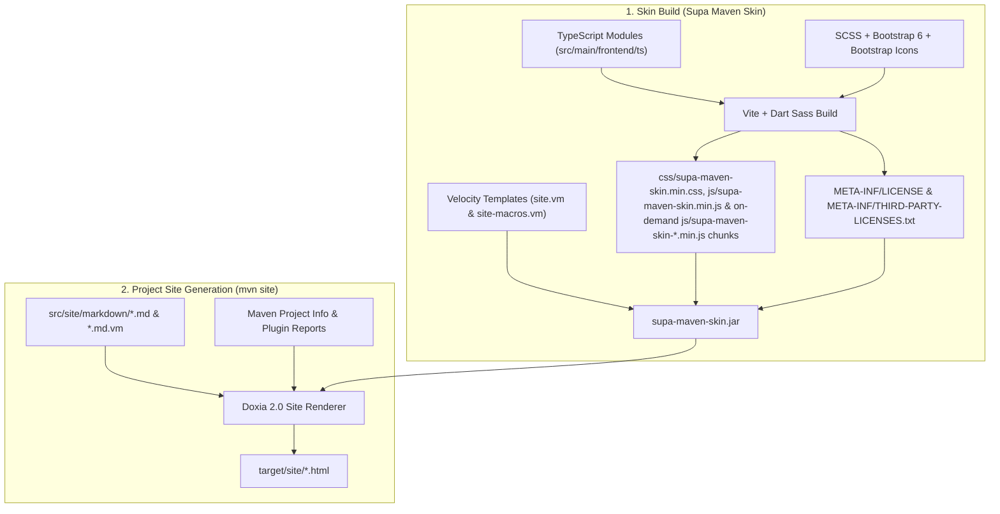

# Architecture & Color System

This page explains how **Supa Maven Skin** bridges Apache Maven's Doxia 2.0 rendering pipeline with **Bootstrap 6 (`6.0.0-alpha.1`)**, Sphinx Furo's 3-column information architecture, and **WCAG 2.2 AA & AAA** accessible color schemes.

---

## Build & Rendering Pipeline

When a Maven project runs `mvn site`, `maven-site-plugin` (`3.21.0+`) and `doxia-site-renderer` (`2.0+`) combine your Markdown/APT/XDoc content and Maven Reports with the skin's pre-bundled assets:

### On-Demand Widget Chunks

`js/supa-maven-skin.min.js` is a single ES module that every page loads. It holds everything the skin's own chrome needs: the theme engine, Doxia normalization, Highlight.js, search, the TOC, and the Bootstrap 6 plugins behind the header menus, tooltips, drawers, search dialog, and ScrollSpy, plus the small data-API plugins (`Alert`, `Button`, `Collapse`, `Popover`, `Toast`, `Toggler`) that cost a few hundred bytes each. The widgets that only author content uses ship as separate chunks beside it, and `bootstrap-components.ts` imports each one with `import()` only when the page contains its markup (`LAZY_WIDGETS`):

| Chunk (`js/supa-maven-skin-<name>.min.js`) | Loads when the page contains |
| :--- | :--- |
| `datepicker` (with its `vanilla-calendar-pro` peer dependency) | `[data-bs-toggle="datepicker"]` |
| `combobox` | `[data-bs-toggle="combobox"]` |
| `chips` | `[data-bs-chips]`, `.chip-input` |
| `otp-input` | `[data-bs-otp]`, `.otp` |
| `range` | `.form-range` |
| `strength` | `[data-bs-strength]`, `.strength` |
| `nav-overflow` | `.nav-overflow`, `[data-bs-toggle="nav-overflow"]` |
| `carousel` | `[data-bs-ride="carousel"]`, `[data-bs-autoplay="true"]`, `.carousel` |
| `tab` | `[data-bs-toggle="tab"]` |
| `playground` (the Component Playground) | `.supa-playground`, `[data-supa-playground]` |

Before the split, the single bundle was 100.5 KiB gzip of its 104 KiB budget. The Datepicker and its calendar library alone added about 18.5 KiB of that, highlight.js and its 18 languages about 29 KiB, the Component Playground 2.4 KiB, and each other widget plugin 0.7&ndash;2.7 KiB. Highlight.js stays in the entry because most documentation pages have code blocks, and loading it later would show the code unhighlighted first. Moving the widgets out brought the entry to 68.6 KiB gzip.

The chunks need no configuration and no extra request on pages without those widgets:

- **Resolution.** `import()` resolves against the importing module's own URL, so the chunks load from `js/` beside the entry on pages at any directory depth. Their names are unhashed, like the skin's other assets, because the JAR is versioned as a whole.
- **One copy of shared code.** Each chunk imports what it shares with the skin (Bootstrap's `base-component.js`, the `dom/data.js` instance map that `bootstrap-components.ts` patches to allow one instance per plugin on an element, `Menu`, and the skin's own helpers) from `js/supa-maven-skin.min.js` itself, so the page keeps one instance of each module. A code-splitting group in `vite.config.ts` keeps all of it in the entry, and a guard plugin fails the build if the entry gains a static import or Rolldown splits off a shared chunk that every page would have to fetch as a second script.
- **Failure tolerance.** A chunk that cannot load (offline, not deployed, blocked by a Content Security Policy) logs one console warning, and its markup stays plain HTML: a datepicker is an ordinary text field, a carousel shows its first slide. The rest of the skin is unaffected.
- **Readiness.** `initSupaSkin()` sets `html[data-supa-ready]` only after every widget chunk the page needed has loaded and initialized (or failed), the same way it waits for Mermaid and KaTeX. Each lazily loaded plugin joins `window.bootstrap` when its chunk loads.

### Bundle Size Budget

Every consumer site downloads `css/supa-maven-skin.min.css` and `js/supa-maven-skin.min.js` on every page, and the widget chunks on the pages that use them, so their size is guarded like contrast is. After Vite finishes, `npm run build` runs `scripts/check-bundle-size.ts`, which prints the raw and gzip size of each file and fails when the CSS bundle, the JS entry, or the widget chunks together exceed their gzip budget, or when a script in `js/` falls under no budget. The shared budget for the chunks means weight moved out of the entry into a chunk, or a new chunk, still has to fit. Maven's `vite-build` execution runs `npm run build`, so `mvn verify` fails on a size regression too. The budgets live in the `BUDGETS` constant of that script: each was the gzip size measured with the Node version Maven pins in `pom.xml`, plus about 5% headroom, rounded up to a whole KiB, and the CSS and JS entry budgets were later raised once, by 4 KiB and 2 KiB, for the planned accessibility fixes. A change that legitimately grows a bundle raises the budget in the same change and states the new size and its cause in `CHANGELOG.md`.

### Packaged JAR Layout & `META-INF/` License Isolation

Because `doxia-site-renderer` extracts all non-`META-INF/` files from a skin JAR directly into a consumer project's `target/site/` directory, `supa-maven-skin.jar` keeps only runtime web assets (`css/supa-maven-skin.min.css`, `css/fonts/bootstrap-icons.woff2`, `css/fonts/bootstrap-icons.woff`, `js/supa-maven-skin.min.js`, and the `js/supa-maven-skin-*.min.js` widget chunks) at the JAR root. All Velocity templates, Maven descriptors, and license files are packaged under `META-INF/`:

- `META-INF/maven/site.vm`, `META-INF/maven/site-macros.vm`, `META-INF/maven/skin.xml` — Velocity layout, macros, and skin descriptor.
- `META-INF/LICENSE` — The project's own MIT License.
- `META-INF/THIRD-PARTY-LICENSES.txt` & `META-INF/licenses/LICENSE-*.txt` — Bundled upstream license notices for every npm package compiled into the CSS bundle, the JS entry, or a widget chunk: `bootstrap` (MIT), `bootstrap-icons` (MIT), `highlight.js` (BSD-3-Clause), and Bootstrap 6's peer dependencies `vanilla-calendar-pro`, `@floating-ui/dom`, `@floating-ui/core`, and `@floating-ui/utils` (MIT). The list lives in `scripts/bundled-licenses.ts`, and the build fails when any emitted file contains a package it does not list: JS packages are found from the module graph of every chunk and Sass packages from the partials' `@use` specifiers, so a new transitive dependency cannot ship without its notice.
- `/*! ... */` **Bundle Legal Banners** — `css/supa-maven-skin.min.css`, `js/supa-maven-skin.min.js`, and every widget chunk begin with a `/*! ... */` copyright and license attribution header referencing `META-INF/LICENSE`. The stylesheet and the entry name every package the skin bundles; a chunk names only the packages compiled into it (the Datepicker chunk names `bootstrap` and `vanilla-calendar-pro`), each with a pointer to `META-INF/THIRD-PARTY-LICENSES.txt`.

---

## Responsive 3-Column Furo Layout

Inspired by Pradyun Gedam's [Furo](https://pradyunsg.me/furo/) theme for Sphinx and aligned with **Bootstrap 6 Docs** breakpoints and prose widths, **Supa Maven Skin** organizes technical documentation into three distinct spatial zones that adapt across viewports using native HTML5 `<dialog>` drawers:

1. **Left Navigation Sidebar (`16rem` / `256px` on `lg+` / `64em+`, `1024px+` at the default font)**:
   - Displays the project brand, dual-theme logo (`<lightLogo>` / `<darkLogo>`), version badge, search trigger (`/`, `Ctrl+K`, or `⌘K`), and hierarchical `
` / `
` navigation menus.
   - Below `lg`, the same DOM node (`<dialog id="supaSidebarDrawer" class="drawer drawer-start">`) acts as an accessible off-canvas Bootstrap 6 left drawer without duplicating navigation markup.
   - Inline, the column is its `<aside>` landmark, named "Primary navigation" by the `navPrimary` label. At those widths the sidebar and the TOC are still closed, non-modal `<dialog>` elements laid out inline, so some screen readers announce them as dialogs. An ARIA role cannot fix that conformingly: Chromium and Firefox both ignore `role="none"` and `role="presentation"` on a `<dialog>`, and ARIA in HTML permits only `alertdialog` there. The planned fix renders the inline columns outside any `<dialog>` and moves them into it only for the drawer.
   - A sidebar link to a section of the same page moves keyboard focus to that section's heading, in the drawer as in the TOC drawer, and in the inline sidebar too. There the browser follows the link itself, but a heading cannot take focus, so browsers focused the viewport and left focus on `<body>`. `index.ts` makes the heading focusable (`tabindex="-1"`, unless the author set one) before the browser follows the link, so the browser focuses the heading, and focuses it a moment later if the browser has not, unless the reader has already moved focus.
   - Menu, breadcrumb, and logo hrefs arrive from `site.xml` relative to the site root. `#supaResolveHref` in `site-macros.vm` prefixes them with Doxia's `$relativePath` (`..` on `guides/install.html`), as Fluido does with `PathTool.calculateLink()`. To find the current page for sidebar highlighting and the Previous / Next cards, the macros compare the site-root-relative href with Doxia's `$currentFileName` (`guides/install.html`), so links, highlighting, and the cards all work at any directory depth.
2. **Center Article Prose (`56rem` / `896px` maximum reading measure)**:
   - Aligns with Bootstrap 6 Docs prose width on desktop (`56rem` max measure with `3rem` horizontal gutters on `xl+`, and a `47.5rem` / `760px` centered container cap below `lg`) while allowing tables and code blocks to scroll horizontally inside `.supa-table-responsive` and `.supa-code-block`.
3. **Right "On this page" Table of Contents (`14rem` / `224px` on `xl+` / `80em+`, `1280px+` at the default font)**:
   - Dynamically constructed at runtime from `h2`–`h4` headings inside `<main id="supa-main-content">` and bound to Bootstrap 6's `ScrollSpy` plugin. An entry whose heading text is in another language than the page, such as `<h4>概要</h4>`, gets the same `lang` (WCAG 2.2 SC 3.1.2).
   - Doxia 2 writes no `id` on headings, so the browser cannot find the heading that a link such as `kitchen-sink.html#definition-lists` names. `toc.ts` scrolls to it as soon as `prepareHeadings()` has given it its ID. Code highlighting, widget chunks, Mermaid, KaTeX, images without dimensions, and late web fonts then reshape the content above it, which left headings far down the kitchen sink hundreds of pixels short. So once `data-supa-ready` is set, the `load` event has fired, and `document.fonts.ready` has resolved, `toc.ts` scrolls to the heading again. It skips that second scroll when the reader has scrolled, clicked, touched, or pressed a key since the page opened, or when the fragment no longer names an element. On a reload, or a Back or Forward to a page not kept in the back/forward cache, the browser restores the reader's place itself, so `toc.ts` makes neither scroll unless the site has set `history.scrollRestoration` to `manual`.
   - Firefox tries the fragment once more right after the `load` event. The HTML gave the heading no ID, so Firefox found nothing while it parsed the page, and now finds the one `prepareHeadings()` gave it and scrolls there, taking a reloaded reader from the place it restored, and a reader who scrolled while the page loaded from where they scrolled to. A page whose HTML holds the ID keeps both. So when the browser restored the reader's place, or the reader has scrolled, clicked, touched, or pressed a key since the page opened, `toc.ts` notes the scroll position at the `load` event, and at the next frame or task, whichever comes first, puts the page back there if it has moved to just where a scroll to the URL's heading puts that heading. A scroll the reader started toward another place, still under way at the `load` event, is left to finish, and so is a link they followed to the URL's own heading, reader input after the `load` event, and a `hashchange` or `popstate` after it. Dragging the scrollbar and find-in-page give no input the skin can see, so a reader who moved only that way is not kept. Chromium does not make that late scroll, so nothing changes there. WebKit scrolls to the fragment on a reload whose `load` event a subresource holds even when the HTML holds the target's ID and the page has no skin CSS or script, so it loses the reloaded reader's place on the kitchen sink, and the skin does not work around it.
   - Smooth scrolling is motion, so it is reserved for readers who have not asked to reduce it. `<html>` gets `scroll-behavior: smooth` only under `prefers-reduced-motion: no-preference`, which covers links within the page and the scrolls to the URL's heading. The "Back to top" button asks `matchMedia` each time it scrolls. On each TOC click, ScrollSpy checks the preference itself and, under reduced motion, scrolls with `behavior: 'auto'`, which that rule makes an instant jump. Otherwise ScrollSpy writes the fragment and focuses the heading only when the smooth scroll ends, wherever focus is by then, so `toc.ts` binds the TOC to `ReaderFocusScrollSpy`, a subclass that remembers the element focused when the scroll began and, if the reader has moved focus since, for example with Tab, writes the fragment without taking focus back.
   - Below `xl`, `<dialog id="supaTocDrawer" class="drawer drawer-end">` opens as a right-hand drawer from the top utility bar. Inline, the TOC is its `<aside>` landmark, named by the `tocTitle` label, with the same closed `<dialog>` inside it as the sidebar. Choosing a section link keeps keyboard focus at its destination after the drawer closes, while the page may still be scrolling there, and a Tab pressed before the scroll ends keeps the focus it moved; Escape and backdrop dismissal return focus to the trigger.

The skin's breakpoints are in `em` (`_breakpoints.scss`). In a media query, `1em` is the browser's default font size, not the page's, so at the usual 16px default `sm`, `md`, `lg`, and `xl` are Bootstrap's own 576, 768, 1024, and 1280px, and the layout is unchanged. A reader who raises the default font, rather than zooming the page, keeps the same CSS width while every `rem` grows, including the sidebar and TOC columns. With px breakpoints, a 32px default font at 1280px kept all three columns and left the article 128px wide, clipping its admonitions. With em breakpoints, the window is 40em wide there, below `lg`, so the article spans it and both columns are drawers, as on a screen half as wide. Bootstrap's own `$breakpoints` stay in px, so an author's responsive classes such as `md:col-6`, Bootstrap's container queries, and the `--breakpoint-*` tokens behave exactly as in Bootstrap. That is also why the chrome uses none of Bootstrap's responsive classes: each `<dialog>` carries the always-on `.drawer`, and `_layout.scss` lays it out inline from `lg` or `xl` up with the same reset that Bootstrap's `lg:drawer` applies, in the same cascade layer, so Bootstrap's drawer script, including the resize check that closes a drawer that is no longer fixed, works unchanged. Before closing a drawer for a section link, `index.ts` asks `matchMedia` the same `(width >= 64em)` and `(width >= 80em)` queries (`SIDEBAR_INLINE_EM`, `TOC_INLINE_EM`) rather than comparing `innerWidth` with px, so the script and the stylesheet agree on which columns are drawers at any font size. The `large-default-font-*` scenarios below check this layout at 24 and 32px defaults.

---

## Doxia 2.0 Normalization & `.prose` Isolation

Maven reports (such as `dependencies.html`, `ci-management.html`, `team.html`, and `plugin-info.html`) emit legacy Doxia HTML patterns (`<table class="bodyTable">`, `<h2>Section Name</h2>`, `<pre><a class="externalLink">`). At page load, **Supa Maven Skin** normalizes these patterns so reports look indistinguishable from hand-authored Markdown pages:

- **Doxia Heading Anchor Reconciliation (`toc.ts`)**:
  - Doxia places `` immediately before or inside headings without setting an `id` on the `<h2>` element itself.
  - `prepareHeadings()` assigns clean URL-friendly slugs (`id="1-actions-buttons"`) while preserving the original Doxia `<a id="...">` anchor and recording `data-doxia-id`, so links to either ID scroll accurately.
  - `slugifyHeading()` keeps the letters, combining marks, and digits of every script (`\p{L}`, `\p{M}`, `\p{N}`), so `Überblick` gets `id="überblick"` and `概要` gets `id="概要"`, and returns the slug in Unicode NFC, so composed and decomposed text give the same ID. It drops emoji (including `ℹ`, which Unicode classes as a letter), their variation selectors, and keycap marks. Slugs of ASCII-only headings are the same as before 0.1.6. Their IDs are too, except that on a page that also has headings with non-ASCII letters, a repeated ASCII heading's `-2` or `-3` suffix can change, because those headings no longer reduce to the same slug. Browsers percent-encode these IDs in URLs (`#%C3%BCberblick`), so the TOC, `hashchange` handling, and the scroll to the URL's heading on page load decode the fragment before they look up the ID. A malformed fragment such as `#100%` is used as written. The `#` permalink copies the percent-encoded URL, which plain-text linkifiers in email and chat keep whole.
  - A heading's accessible name comes from its content, so a `#` permalink inside it added its label to the heading's name: screen readers listed "Install Permalink to Install". When `prepareHeadings()` adds a permalink, it moves the heading's text into a `` and points the heading's `aria-labelledby` at it, so the heading is named by its text alone. The permalink stays inside the heading rather than becoming a sibling: there it keeps its place after the last word on screen, its hover and focus reveal, its place in the Tab order right after the heading that a section link focuses, and its absence from print, and the heading's ID, the TOC text, and the search index, which all read the heading's text without the permalink, are unchanged. A heading that already has an `aria-label` or `aria-labelledby` keeps it. The span IDs are given last and numbered if taken, so they never claim an ID a heading or a Doxia link anchor needs. The `heading-names` scenario of `npm run test:a11y` reads every heading's and permalink's name from Chromium's accessibility tree.
  - Doxia rewrites the fragment of a relative link in a Markdown page when it is not a valid Doxia ID (`DoxiaUtils.isValidId`: an ASCII letter or `_`, then only ASCII letters, digits, `_`, `-`, and `.`): `DoxiaUtils.encodeId` turns `[Überblick](#überblick)` into `href="#a.C3.BCberblick"`, `[1. Install](#1-install)` into `href="#a1-install"`, and the percent-encoded `#%C3%BCberblick` into `#a.25C3.25BCberblick`. So that the first two forms work, `prepareHeadings()` adds an empty `<a id="a.C3.BCberblick">` or `<a id="a1-install">` before each heading whose ID Doxia would rewrite, which is every ID with a non-ASCII character or a leading digit (`doxiaLinkId()` ports both methods), records it on the heading as `data-doxia-link-id`, and the TOC and `hashchange` handling treat that ID as an alias of the heading. The anchors go in only after every heading on the page has its ID, so an anchor never pushes a later heading's slug to a `-2` suffix (`a1-install` is also the slug of `A1 Install`). An anchor whose ID an element already has (a heading, Doxia's own anchor, or an author's `id`) is left out, and the link reaches that element. `.supa-article a[id]:empty` gives the anchors the headings' `scroll-margin-top`, so a link lands at the same place whichever ID it names. `src/it/sample-site/verify.bsh` checks Doxia's output for a non-ASCII and a digit-first link, so a change in Doxia's encoding fails the build, and the `numbered-heading-link` scenario of `npm run test:a11y` follows a digit-first link on `components.html` in Chromium.
- **Responsive Table Classification (`doxia.ts`)**:
  - `normalizeDoxiaTables()` upgrades `table.bodyTable` into `.table.table-hover` inside `.supa-table-responsive` and classifies columns into `.supa-table-col-compact` (single-line identifiers/defaults) vs. `.supa-table-col-prose` (multi-sentence descriptions) so inline `<code>` tokens never wrap mid-word.
- **Keyboard-Scrollable Regions, Report Images, Disabled Links, Navigation Names & Channel Navigation (`doxia.ts`)**:
  - `initScrollRegions()` gives `.supa-table-responsive` and `.supa-code-block > pre` a `tabindex="0"` only while they overflow (re-checked on resize), so keyboard users can scroll wide tables and code without adding a tab stop to every short block.
  - `labelReportAvatars()` marks the Team report's Gravatar `` (emitted without `alt`) as decorative, because the adjacent cell already names the member.
  - `markDisabledPageLinks()` restores Bootstrap's `aria-disabled="true"` and `tabindex="-1"` on `.page-item.disabled > .page-link` and `.page-link.disabled`. Doxia's Markdown sink keeps only base attributes (`class`, `href`, `id`) on raw-HTML links and list items, which left a disabled page link in the tab order, announced as an enabled link, and held to the text contrast that WCAG waives for inactive controls.
  - `restoreNavigationNames()` gives each `<nav>` in the article that has a `title` but no `aria-label` or `aria-labelledby` the `aria-label` its title names, and removes the title. Doxia keeps a raw-HTML `<nav>`'s `title` but drops its `aria-label`, so the authoring guide names navigation with `title`. It runs before `initTooltips()`, which would otherwise turn the title into a Bootstrap tooltip and leave the landmark unnamed, and only on the article: the skin's own navigation and the `site.xml` `<head>` and `<footer>` markup do not pass through Doxia and keep the names they are written with.
  - `restoreDocumentationChannels()` gives a `.supa-documentation-channels` or `.documentation-channels` navigation the `aria-label` its `title` names, removing the title, and adds `aria-current="page"` to each `a.active` link inside it. Doxia's sinks drop `aria-*` and `data-*` attributes from raw-HTML `<nav>` and `<a>` elements in Markdown, `.md.vm`, and XDoc pages, but keep `title` and `class`, so the recipe uses those as hooks. It runs on the whole document, since the navigation may sit outside the article, never infers the current page from URLs, and keeps a name or `aria-current` that reached the page.
- **Raw-HTML Components in Markdown (Doxia)**:
  - Doxia turns every `<h1>`–`<h6>` in a page into a document section, even inside a raw-HTML component: `
<h5>` opens a `<section>` in the card, which the browser closes with the card's `
`, and Doxia's own `</section>` later closes the page's real sections early, so the headings after the card leave the sections they belong to. A title inside a component is therefore a heading-styled `
`, as `#bsCard` writes it. A `<button>` takes only phrasing content, so the color scheme cards on the configuration page lay out their header, description, and swatches with ``s, which the card's flex column lays out as blocks.
  - Doxia keeps `role` on a raw-HTML `<button>` but drops it from `<ul>`, `<li>`, and `
`, so a Bootstrap tab demo reaches the page with `role="tab"` buttons in a plain list and panels without `role="tabpanel"`. `bootstrap-components.ts` creates the active tab's `Tab` instance when the Tab chunk loads, and Bootstrap's Tab then sets `role="tablist"` on the list, `role="presentation"` on its items, and `role="tabpanel"` on each panel, keeping any role that reached the page.
  - `npm run test:a11y` fails a page on which a `<section>` opens inside another element, a `<button>` holds an element that is not phrasing content, a Bootstrap tab's panel is not a `tabpanel` once the skin has run, or a navigation landmark has no name.
- **Bare-URL Links (`site.vm`)**:
  - Autolinks and report links whose text is their own URL (`<a class="externalLink" href="https://…">https://…</a>`) get a `data-supa-bare-url` attribute when `site.vm` writes the page body, so the print stylesheet, which prints the URL after an external link, does not print it twice. CSS cannot compare an element's text with an attribute, so the template marks these links with one regular expression over Doxia's output.
- **`.prose` vs. `.not-prose` Isolation (`bootstrap-components.ts`)**:
  - Bootstrap 6's `.prose` class styles article paragraphs, lists, and tables. `isolateBootstrapComponentsFromProse()` automatically adds `.not-prose` to interactive Bootstrap 6 components (`.card`, `.alert`, `.accordion`, `.nav`, `.stepper`, `.chip-input`) so prose list/margin rules never collide with UI widgets.

---

## WCAG 2.2 AA & AAA Accessible Color System

**Supa Maven Skin** ships with 6 color schemes across Light and Dark polarities (12 total theme surfaces), verified at build time by `scripts/lint-scss.ts`:

| Tier | Palettes | Minimum Contrast Guarantees |
| :--- | :--- | :--- |
| **WCAG 2.2 AA** | `furo`, `bootstrap` | &ge; `4.5:1` for every text and link color on every audited surface (primary and secondary backgrounds, admonition title bars and bodies, `.alert.theme-*` callouts, inline code on each of these and on table cells, cards, list groups, and accordions, sidebar, TOC, and search-result states, and Bootstrap 6 components with and without a theme, at rest, hovered, and toggled on); &ge; `3.0:1` for interactive UI borders and admonition icons. |
| **WCAG 2.2 AAA** | `modus`, `modus-tinted`, `modus-deuteranopia`, `modus-tritanopia` | &ge; `7.0:1` for every text and link color on every audited surface; &ge; `4.5:1` for interactive UI borders and admonition icons; colorblind-safe semantic palettes for deuteranopia and tritanopia. |

### How the Contrast Audit Works

`scripts/lint-scss.ts` compiles `main.scss` with Dart Sass and hands the CSS to `scripts/contrast-audit.ts`. For each palette and polarity, the audit collects the custom properties that apply to `<html>` the way the browser's cascade does (matching selector, specificity, source order), then resolves `var()`, `light-dark()`, `rgb()`, `oklch()`, relative `oklch(from ...)` colors (which Bootstrap 6 uses to darken button states), and `color-mix()` in OKLCH or sRGB down to sRGB. The resolver reproduces Chromium's rendering, including its rule that a near-neutral color mixed in OKLCH has no hue, so the colors it measures are the colors the page paints.

What it measures is the `SURFACE_AUDITS` list: each surface's background layers, written as the CSS the painting rule uses, and every foreground drawn on it:

| Surface | Background layers (bottom first) | Foregrounds |
| :--- | :--- | :--- |
| Page | `--color-background-primary` | All 11 semantic text and accent tokens (text); `--color-foreground-border` (non-text) |
| Secondary surface | `--color-background-secondary` on the page | All 11 semantic text and accent tokens (text) |
| Checked themed Bootstrap switch track (covered by the solid-fill audit) | `--theme-bg` on the page | Knob `--theme-contrast` (non-text); disabled switches retain Bootstrap's ink and fading |
| Bootstrap range (neutral, and preserved inverse theme) | Unfilled track and page | Thumb and progress fill (`--color-foreground-primary`, or `--inverse-bg` for `.theme-inverse`, non-text); the protruding thumb identifies the value |
| Bootstrap form boundaries | Page and secondary surfaces | Unchecked `.check` and `.radio` borders, `.switch` edge, enabled range track boundary, `.form-control`, `.chip-input`, and OTP slot borders (`--supa-control-border`, non-text) |
| Unchecked Bootstrap switch track, with or without a theme | `--bg-3` on the page and secondary surfaces | Knob `--color-foreground-primary` (non-text): its position shows the off state |
| Bootstrap focus ring | Page, secondary, item, and hover surfaces | `--primary-focus-ring` (non-text) |
| Palette-menu keyboard focus | `--bg-body` on the page, under `--bg-body` or `--bg-1` | Outline `--color-brand-content` (non-text) |
| Documentation channels | Page, secondary, and hover surfaces | Links, summary, and current link `--color-foreground-primary` (text, which also covers the control border and focus outline, whose non-text target is looser; on the secondary surface the Secondary surface row measures it) |
| Admonition title bar (one per kind) | `--supa-admonition-<kind>-bg` on `--color-admonition-background` on the page | Title text `--color-foreground-primary` and title link `--color-brand-content` (text); icon `--supa-admonition-<kind>-accent` (non-text) |
| Admonition body | `--color-admonition-background` on the page | Body text and link (text) |
| `.alert.theme-<name>` (every Bootstrap 6 theme: `primary`, `accent`, `success`, `info`, `warning`, `danger`, `secondary`, `inverse`) | `--<name>-bg-subtle` on the page | Text `--<name>-fg` and link (text); the text is also how every `.theme-<name>` subtle fill paints, so that row is not repeated below |
| `.alert` without a Bootstrap theme (`[!ALERT:light]`, `[!ALERT:dark]`) | `--bg-1` on the page | Inherited text and link (text) |
| Inline code (`:not(pre) > code`) on the page, the secondary surface, every admonition title bar, the admonition body, and every `.alert` above | `--color-inline-code-background` on that surface | `--color-inline-code-text` (text) |
| Inline code in table cells and Bootstrap 6 components: a hovered, striped, or active (`.table-active`) cell, a hovered header cell, the item surface (`--bg-2`: an open unthemed accordion summary, a pressed unthemed list-group action), and, for every Bootstrap 6 theme, a hovered `.list-group-item-action` and the solid fill of a `.card-header`, `.card-footer`, or active `.list-group-item` | `--color-inline-code-background` on the cell's 7.5%, 5%, or 10% `--fg-body` tint (over the page, or the secondary surface for a header cell), on `--bg-2`, on `--<name>-bg-muted`, or on the page color laid over `--<name>-bg` | `--color-inline-code-text` (text) |
| Sidebar link: at rest, hovered, current page | `--color-background-secondary` on the page, under `--color-background-hover` (hovered) or `--supa-nav-active-bg` (current) | `--color-foreground-primary`, `--supa-nav-hover-fg`, `--supa-nav-active-fg` (text) |
| TOC current section | 6% `color-mix(in srgb, ...)` brand tint on the page | `--color-brand-primary` (text) |
| Search result, active or hovered | `--color-background-hover` on the page | Title `--supa-nav-hover-fg`, snippet `--color-foreground-secondary` (text) |
| Search match highlight (`<mark>`), in a result and in the active result | `--supa-search-mark-bg` (a 22% brand tint) on the result's surface | `--supa-search-mark-fg` (text) |
| Item badge (`.supa-search-result-badge`, `.supa-version-badge`) | `--color-background-item` on the sidebar | `--color-foreground-secondary` (text) |
| `.theme-<name>` solid fill (`.btn`, `.badge`, `.avatar`, `.page-link.active`, `.chip.active`, `.card-header`, `.card-footer`, checked switch knobs, ...) for every Bootstrap 6 theme | `--<name>-bg` on the page | `--<name>-contrast` (text) |
| `.theme-<name>` outline button toggled on (`.active`, checked `.btn-check`) | `--<name>-bg` darkened with `oklch(from ... calc(l * .9) calc(c * 1.15) h)` | `--<name>-contrast`, darkened the same way (text) |
| `.theme-<name>` outline, text, and link variants | The page | `--<name>-fg` (text) |
| `.theme-<name>` subtle fill with emphasized text (`.toast-header`, `.card-subtle` header and footer, a hovered `.page-link` or `.menu-item`, ...); the `--<name>-fg` text of `.btn-subtle`, `.badge-subtle`, `.avatar-subtle`, `.chip`, and `.list-group-item` is the `.alert.theme-<name>` row | `--<name>-bg-subtle` on the page | `--<name>-fg-emphasis` (text) |
| `.theme-<name>` solid button hovered and toggled on | `--<name>-bg` darkened to `l * .93` (hovered) or `l * .9` (toggled on) by the override in `_bootstrap-supa.scss` | `--<name>-contrast` (text) |
| `.theme-<name>` outline button hovered | `--<name>-bg` darkened to `l * .95` | `--<name>-contrast`, darkened the same way (text) |
| `.theme-<name>` subtle and text buttons, hovered and toggled on | `--<name>-bg-subtle`, mixed half and half with `--<name>-bg-muted` for a hovered subtle button | `--<name>-fg-emphasis` (subtle) or `--<name>-fg` (text), darkened to `l * .95` or `l * .9` in light polarity only (text) |
| `.theme-<name>` link hovered | The page | `--<name>-fg-emphasis` (text) |
| `.theme-<name>` muted fill: hovered `.chip`, `.nav-link`, and `.list-group-item-action` | `--<name>-bg-muted` on the page | `--<name>-fg` (chip) and `--<name>-fg-emphasis` (text) |
| `.theme-<name>` selected chip hovered (`.chip.active:hover`) | `--<name>-bg` on the page, faded as a whole to `--supa-chip-selected-hover-opacity` | `--<name>-contrast`, faded with it (text) |
| Unthemed `.btn`, `.chip`, `.badge`, at rest and hovered, pressed, or toggled on (also `theme-light` and `theme-dark`, which Bootstrap 6 does not define) | `--bg-2` at rest, `--supa-bg-active` when hovered, on the page | `--fg-body` (text) |
| Datepicker calendar, at rest and with a day, month, or year hovered | `--bg-body`, under `--bg-1` when hovered | Days and the header's month and year `--fg-body`; weekday names and the month and year cells `--fg-3`; days outside the shown month `--color-foreground-muted` (text) |
| Datepicker today and selection (a selected day, month, or year, and every day of a selected range, measured opaque: the `datepicker-range-switched` scan guards the opacity) | `--bg-2` (today) or `--primary-bg` (selection) on the calendar | `--fg-1` (today) and `--primary-contrast` (selection) (text) |
| Tooltip and range-slider value bubble | `--fg-body` on the page or secondary surface, faded as a whole to `.95` opacity | Text `--bg-body`, faded with the fill (text) |

The `.theme-<name>` rows mirror Bootstrap 6's component rules and the skin's overrides of them in `_bootstrap-supa.scss`. A pressed (`:active`) button keeps its hover colors, because Bootstrap applies the toggled-on colors only to `.active`, `.show`, and checked `.btn-check` buttons. An element drawn at reduced `opacity` is composited as a group over the surface beneath it, so its fill and its text both fade, as axe measures them.

Bootstrap derives these states by darkening (`oklch(from ... calc(l * .95) ...)`), which raises text contrast on a light fill and lowers it on a dark one, and from `bg-muted` fills that are darker than the subtle fill in light mode. Three fixes keep every state at its target: in dark polarity, hovered and toggled-on text and subtle buttons keep their resting text color; the `modus*` schemes move each theme's `--<name>-bg-muted` halfway from its subtle fill to the page, where text that meets 7:1 on both still does; and Bootstrap's dark `secondary` and `inverse` muted fills, which were lighter than the text drawn on them, step toward the page in every scheme.

The Datepicker calendar is vanilla-calendar-pro drawn by Bootstrap 6's own `[data-vc]` rules, whose `--datepicker-*` tokens read the `--bg-*` and `--fg-*` steps. Bootstrap fades the days outside the shown month to 50% and the days inside a selected range to 80%, which left day numbers at 3.4:1 in `furo` light and 5.3:1 in `modus` dark. Both are buttons that pick a date, so `_bootstrap-supa.scss` keeps them opaque and marks a day outside the month with the muted text of the weekday names. A disabled day fades to 50% instead: Bootstrap marks it only with `--fg-4`, which the skin also sets to the muted text, and a disabled control is exempt from the contrast minimum. The skin also makes the calendar inherit the page's `color-scheme`: Bootstrap gives the calendar its own `light dark`, which followed the operating system rather than the page once a reader switched from `auto` to an explicit theme. Every token resolves on `<html>`, so no color depends on that today, but a `light-dark()` declared on the calendar, and the browser's own colors, would.

Article links use `--color-brand-content`, including links inside alerts and custom admonition titles, which keep their inline markup. Solid themed card-header and card-footer links use `--theme-contrast` with the cap text, so the audit measures that ink on each theme fill. Translucent backgrounds, such as the `rgba()` admonition tints of the `furo` and `bootstrap` dark polarities, those palettes' inline-code backgrounds, and the table row tints Bootstrap paints as an inset `box-shadow`, are alpha-composited over the layer beneath before measuring. Over a solid themed fill, a translucent inline-code background lets the saturated color through under page-colored text (as low as 1.01:1), so `_content.scss` lays inline code in a themed `.card-header` or `.card-footer` (not in a `.card-subtle` or `.card-translucent` card, whose caps paint their own fill) or an active `.list-group-item` over the page color, and the audit measures that stack. The internal `--supa-solid-code-background` value follows theme inheritance: `.theme-reset` clears it, and a theme inside the reset restores it. The audit cannot see the rule itself, so the `inline-code-solid-fills` scenario below measures it rendered. An undefined layer counts as transparent, as it does in CSS, which is why `--color-admonition-background` (defined by no built-in palette) still sits in the title bar's stack: a palette that defines it is measured with it.

Dart Sass compiles `[data-supa-palette="furo"]` to `[data-supa-palette=furo]`, so the audit fails when it cannot find a palette's rule instead of silently measuring nothing, and its success line states how many foreground/surface pairs it checked (currently 3,060). To cover a new surface, add an entry to `SURFACE_AUDITS`.

### Modus Palette Overrides

Bootstrap 6's own grays and state fills fall short of 7:1 in places, so the four `modus*` schemes override them. A site author can still set any of these tokens in `<lightCssVariables>` and `<darkCssVariables>`; this section explains why the defaults differ.

- **Secondary theme.** `.theme-secondary` text and subtle surfaces (secondary alerts, outline buttons, and subtle badges) follow `color-foreground-muted` on `color-background-secondary`. Dark solid secondary fills (buttons, badges, avatars) use Modus Vivendi's `#505050` mode-line gray (`#484d67` in `modus-tinted`) under white.
- **Inverse theme.** Light `.theme-inverse` subtle surfaces in `modus-tritanopia` use `color-background-item`, because Bootstrap's light inverse surface leaves the teal link at 6.9:1.
- **Muted fills.** The muted fills of hovered chips, nav links, and list-group actions (`--<theme>-bg-muted`) sit halfway between each theme's subtle fill and `color-background-primary`.
- **State tokens.** Hovered sidebar links keep `color-foreground-primary`. The current page's brand tint (`supa-nav-active-bg`) is mixed into `color-background-primary` instead of laid over the sidebar; dark `modus-tinted` uses 4% instead of 12%, because 12% matched the sidebar. Hovered unthemed buttons and chips (`supa-bg-active`) use Modus Vivendi's `#535353` gray (`#4a4f69` in `modus-tinted`) in dark polarity, and a hovered selected chip stays opaque (`supa-chip-selected-hover-opacity` is `1`).

In every scheme, Bootstrap's dark `.theme-secondary` and `.theme-inverse` muted fills step toward the page, because Bootstrap's own were lighter than the text on them. The audit above measures each of these states.

The themed range slider is a different kind of rule: it applies in all six schemes, and it is a component rule on `.form-range` in `_bootstrap-supa.scss`, not a token that `<lightCssVariables>` or `<darkCssVariables>` can set. An enabled themed range keeps neutral thumb and fill colors (`color-foreground-primary`), except `.theme-inverse`, because the other theme fills fail the non-text target in at least one palette variant.

### Build-Time Tokens vs. Rendered-Page Checks

Accessibility is verified in two layers that catch different classes of bugs:

| Layer | Command | Runs in | What it proves |
| :--- | :--- | :--- | :--- |
| **Token contrast** | `npm run lint:scss` (`scripts/lint-scss.ts`) | `npm run lint` and `mvn verify` | Every foreground/surface pair in `SURFACE_AUDITS` (`scripts/contrast-audit.ts`) meets its AA/AAA ratio in all 12 palette &times; polarity variants, resolved from the compiled CSS before any HTML exists. |
| **Rendered pages** | `npm run test:a11y` (`scripts/a11y-check.ts`) | CI (its own job, on the sites the JDK 21 build renders; a release publishes only after this run succeeds for its tagged commit) and on demand | The HTML that Velocity, Doxia, the CSS bundle, and the TypeScript enhancers actually produce passes axe-core's `wcag2a`, `wcag2aa`, `wcag21a`, `wcag21aa`, and `wcag22aa` rules: landmarks, names, roles, keyboard reachability, link distinguishability, and computed contrast. On the `modus*` palettes it also passes the AAA `color-contrast-enhanced` rule (7:1). |

`npm run test:a11y` serves `target/site/` from an in-process Node server and opens it in headless Chromium (Playwright), or in Firefox or WebKit on request (below). It scans every top-level page (docs and `maven-project-info-reports-plugin` reports) in `furo` light and dark at 1440&times;900, `index.html` in all 12 palette &times; polarity variants (seeded through the same `supa-theme` / `supa-palette` `localStorage` keys the `<head>` script reads), and `index.html` at a 390&times;844 phone viewport. Before scanning it waits for `html[data-supa-ready="true"]`, which `initSupaSkin()` sets once every enhancer, including the asynchronous Mermaid/KaTeX loaders and the on-demand widget chunks, has settled. Because the boot catches an enhancer's error so the others still run, and sets `data-supa-ready` anyway, every scan also listens for an uncaught page error and for any `console.error`, and fails the job when one occurs, so a throwing enhancer cannot pass unnoticed. It fails the job, too, when the page requests a file the site does not have, such as an image, a font, or a widget chunk whose failure only leaves the widget as plain HTML; `css/site.css`, which `site.vm` links but a site may remove, is the one exception. It judges a failed request by its URL and the server's answer, not by the engine's console wording, and lets requests to other origins, such as the Mermaid and KaTeX CDN, fail. Any violation fails the run with the page, variant, rule ID, impact, target selector, and help URL.

The same run scans the site that `maven-invoker-plugin` renders for each project in `src/it/` (`target/it/<name>/target/site/`). These fixtures take template branches that the self-site's own configuration never takes: a hidden brand name, footer icon links, author colors, a second locale, options turned off, and the legacy `<furoSkin>` block. Each fixture site is served on its own origin. Every page in it, including subdirectories such as `localized-site`'s `fr/`, is scanned in `furo` light and dark at 1440&times;900, and its `index.html` at 390&times;844. A fixture whose site was not rendered is skipped with a note, and `--require-fixtures`, which CI passes, turns that into an error, so an artifact that lost the fixture sites cannot pass. The fixtures set their own author colors, which must pass like any consumer site's. Name a fixture (`npm run test:a11y -- sample-site`) or one of its pages (`localized-site/fr/index.html`) to narrow the run.

The AA tags check text contrast at 4.5:1 only, so every `modus*` job, page scans and interaction scenarios alike, also runs axe's `color-contrast-enhanced` rule (WCAG 1.4.6, 7:1 for text). It is the only AAA rule enabled. Before scanning, the run reads the palette's `--supa-wcag-level` from the page and fails if it disagrees with the AAA palettes the script lists, so a scan never measures a palette against the wrong target. The runner prints the scanned variant totals for the current matrix at the end of each run.

Every scan except the scoped ones described below also checks WCAG 2.5.3 Label in Name on each visible color-scheme trigger (`.supa-palette-btn`): its accessible name must contain the scheme name it shows, as "Color scheme: Furo (AA)" contains "Furo (AA)", so a voice-control user can activate it by saying what they see. axe's own `label-content-name-mismatch` rule runs under `wcag21a`, but it drops parenthesized text before comparing, so it passed a trigger that showed "Furo (AA)" and was named "Accessible color scheme: Furo Default (AA)".

In the Datepicker's month view, axe's own rule does catch the mismatch (the `datepicker-months` scenario below): vanilla-calendar-pro shows each month's short name ("Jan") but sets the long one ("January") as the button's `aria-label`. When the Datepicker chunk loads, `bootstrap-components.ts` adds an `onCreateMonthEls` hook to Bootstrap's `Datepicker.Default.vcpOptions`, which Bootstrap hands to every calendar it creates, and the hook removes that label, so the browser names each button by its text in any locale. The calendar calls the hook for every month each time it draws the month view, after a trip through the year view or a re-render too, so no `MutationObserver` is needed. Removing the label rather than copying the text into it keeps a single source for the name, and a button without text keeps its label. A picker given its own `vcpOptions`, in script or through a `data-bs-vcp-options` or `data-bs-config` attribute, replaces Bootstrap's defaults whole, hook included, which [the Components page](components.html) tells authors how to avoid.

Every unscoped scan also fails when two elements on the page share an `id`. A fragment link reaches only the first of them, so a heading ID, or an anchor that `prepareHeadings()` adds, that repeats another ID would send links to the wrong place. axe's own `duplicate-id` rule is deprecated, as WCAG 2.2 dropped success criterion 4.1.1 Parsing, and no longer runs under the WCAG tags.

Every unscoped scan of the documentation site (not the fixture sites, where `sample-site` repeats `index.html` on purpose to test the "About" report item) also fails when two sidebar items link to the same destination, for example a `site.xml` shortcut for a page that a project-info report already lists under Project Information. Items that differ in their `#fragment` count as different destinations.

Every unscoped scan also fails when a sidebar item links a `#fragment` of the page it is on and no element on the page has that ID. Doxia gives headings no IDs, and `prepareHeadings()` assigns them in the browser, so a `site.xml` section link whose slug does not match its heading can only be caught on the rendered page. Every page is scanned, so every section link in the sidebar is followed on its own page.

Before every scan, the run waits for the page's running CSS transitions to finish, so axe measures settled colors rather than a fade: a search result leaving the active state switches its title color at once while its fill fades, and a scan taken mid-fade measured brand text on the hover fill. The run also waits for the page to stop scrolling, and repeats the wait until two frames pass with no scroll and no transition: a smooth scroll that outlasts a scenario's setup carries code blocks under the resting pointer, and the language label each one hides on hover would otherwise be measured halfway through its fade. Animations are not awaited, since a spinner never ends.

A page scanned right after load shows the skin's chrome closed, so the same run also scans **interaction scenarios**, by default in `furo` light, `furo` dark, and `modus` dark (AAA); a scenario can list its own palette &times; polarity `variants` instead. Each scenario names a page and viewport, drives the page with Playwright locators, the keyboard, and the mouse, and then scans it:

| Scenario | Page and viewport | State scanned |
| :--- | :--- | :--- |
| `control-boundaries-focus` | `components.html`, 1440&times;900, all 12 variants | Unchecked checkbox, radio, and switch edges, unthemed and themed unchecked knobs on their tracks, checked themed knob contrast and unchanged disabled ink and fading across all eight themes, form-control, chip-input, and empty OTP slot boundaries, their normal/valid/invalid validation borders, range track boundary contrast against page and secondary surfaces, neutral and inverse range thumb and fill contrast against the track, the thumb against the page, OTP slot borders against secondary surfaces, preserved disabled range and OTP tokens, and a keyboard-focused inactive nav pill. The showcase has no radio, so the scenario adds an unchecked one beside the checkbox |
| `toc-link-focus-mobile`, `toc-link-focus-tablet`, `toc-link-focus-smooth-mobile`, `toc-link-focus-smooth-tablet` | `configuration.html`, 390&times;844 and 1024&times;768, reduced and allowed motion, `furo` light | A drawer section link keeps focus at the heading after closing, Tab continues into or after that section, and the element Tab reached keeps focus once the fragment is written and the scroll has stopped |
| `sidebar-link-focus-mobile`, `sidebar-link-focus-desktop`, `sidebar-link-focus-smooth-mobile`, `sidebar-link-focus-smooth-desktop` | `customizing.html`, 390&times;844 (the navigation drawer) and 1440&times;900 (the inline sidebar), reduced and allowed motion, `furo` light | A sidebar link to a section of the same page, followed with Enter, moves focus to the section's heading, after closing the drawer below `lg`; Tab continues into or after that section, and the element Tab reached keeps focus once the page has settled |
| `reduced-motion-transforms` | `configuration.html`, then `components.html` in a second tab, 1440&times;900, `furo` light, under reduced motion | A palette card the pointer has just reached has no transform, and no element on `configuration.html`, nor its `::before` or `::after`, transitions `transform` (or `all`) for a non-zero time, and neither does the code toggle chevron on `components.html`, so the card, the palette picker chevron, the sidebar group chevrons, and the code toggle chevron change state without moving |
| `heading-names` | `configuration.html`, 1440&times;900, `furo` light; Chromium only, whose DevTools protocol exposes the computed accessibility tree (`Accessibility.getPartialAXTree`) | Every article heading with a permalink is exposed as a heading named by its own text, without the permalink's label, and every permalink is a focusable link, not left out of the tree, named "Permalink to" its heading |
| `drawer-roles-16-1100`, `drawer-roles-16-390`, `drawer-roles-20-1440`, `drawer-roles-24-1440` | `getting-started.html` at 1100&times;900 and 390&times;844 with the 16 px default font, and at 1440&times;900 with the default font raised to 20 px (72em: the sidebar inline, the TOC a drawer) and 24 px (60em: both drawers), `furo` light; Chromium only, whose DevTools protocol exposes the computed accessibility tree and sets the font | A column that is a drawer at that font and width is left out of the tree while closed, opens from its trigger as a modal dialog named by its title, and closes on Escape; an inline column is exposed as its `<aside>` complementary landmark, named by its label |
| `large-default-font-{kitchen-sink,configuration}-{24,32}-{1280,1440}` | `kitchen-sink.html` and `configuration.html` at 1280&times;900 and 1440&times;900 with the browser's default font raised to 24 px (Chrome's "Very large") and 32 px (twice the default), `furo` light; Chromium only, which sets the font through its DevTools protocol (`Page.setFontSizes`) | The article's content box is at least 20em of that font wide, the width of a 320 px phone screen (WCAG 1.4.10 Reflow) scaled to it, and no box in the article that hides its overflow clips text; the sidebar and the TOC each work: inline beside the article, or as a drawer that opens inside the viewport and closes when a section link is followed (or on Escape when the sidebar shows none), with focus on the section or back on the trigger, which proves `index.ts` and the stylesheet agree on the breakpoint |
| `forced-colors-controls-tabs`, `forced-colors-palettes`, `forced-colors-search` | `components.html` (controls/tabs and search), `configuration.html` (palettes), 1440&times;900, `furo` light/dark | Forced-colors system ink, selected-state cues, selected-tab underline, and distinct keyboard focus on selected tabs and results, and on selected and unselected palette cards and menu options, including outline contrast against their own and surrounding fills. Controls/tabs also verify visible native range thumb, track border, and progress pixels, and scan those widgets. A unit test compiles the forced-colors SCSS and checks that both vendor tracks discard author shadows. |
| `forced-colors-states` | `components.html`, 1440&times;900, `furo` light/dark with forced colors | Selected, current, pressed, checked, and disabled states that Bootstrap draws only with fills or lighter text, which forced colors repaints as the page's `Canvas` and text colors: a checked radio, enabled and disabled, the active nav pill, the current page link, active and pressed buttons, a checked checkbox and radio toggle button (`.btn-check`), a disabled list-group item and nav link, an active chip and list-group item, an active stepper item's counter and connector, and a pressed playground pill. Each element is photographed in and out of its state, and a share of its pixels must change by more than 48 levels on a channel, which tolerates antialiasing. In the state, each line of text, and a stepper counter's digit, must reach 4.5:1 against the most common pixel of its line box, which is what is painted under it, including the `Canvas` backplate Chromium draws behind forced text, and the text's computed color must appear there. The disabled page link, list-group item, and nav link must compute `GrayText`, unlike enabled ones, a link inside a selected list-group item must stay underlined and show keyboard focus, and a keyboard-focused nav pill, playground pill, and checkbox and radio toggle button must look different from their resting selection, unselected or selected. With only its first item active, the showcase stepper's inactive counters and its connectors from the last active item and between inactive items must stand out from the page, photographed with the stepper shown and hidden, and an inactive digit must read. The showcase has no radio, toggle button group, active list-group item, or disabled list-group item or nav link, so the scenario adds them, an active item with a link, secondary text, and a badge, and scans the whole page |
| `forced-colors-pages` | Every top-level page, 1440&times;900, `furo` light/dark with forced colors | Unscoped page scans with no rule or element exclusions. OS colors override palette colors, so repeating all 12 palette variants adds no coverage. This emulates Chromium forced colors; real Windows High Contrast remains untested. |
| `forced-colors-popover` | `components.html`, 1440&times;900, `furo` light/dark with forced colors | Open popover title/body system ink, box border, and arrow triangle transparency, before and after an unscoped axe scan. Only the decorative arrow pseudo-elements retain their transparent borders with `forced-color-adjust: none`; their outline and fill use `CanvasText` and `Canvas`. Computed-style assertions require nonzero triangle sides in `CanvasText` and `Canvas`; Chromium otherwise turns the arrow into a solid rectangle. |
| `range-tooltip`, `forced-colors-tooltip` | `components.html`, 1440&times;900; `range-tooltip` in all 12 palette &times; polarity variants, `forced-colors-tooltip` in `furo` light/dark with forced colors | The range slider's value bubble, which reuses Bootstrap's tooltip markup and is always shown, scrolled into view. In forced colors the scenario also asserts that the bubble's text color and `-webkit-text-fill-color` both resolve to `CanvasText` (Chromium paints forced text in `CanvasText` but otherwise reports the fill as Bootstrap's `--tooltip-color`, which axe reads first and measured at 1.12:1 on black) and that a `CanvasText` border separates the bubble, whose fill forced colors turns into `Canvas`, from the page. Both scan only the bubble |
| `search-dialog-empty` | `index.html`, 1440&times;900 | Search dialog opened with Ctrl/Cmd+K, before a query is typed; the dialog must be named "Search" |
| `search-dialog-results` | `index.html`, 1440&times;900 | Search dialog opened from the sidebar button, searching a word that page titles contain (so matches are highlighted in titles and snippets), with the second result active after ArrowDown; the combobox active descendant must match the selected option |
| `search-dialog-no-results` | `index.html`, 1440&times;900 | Search dialog searching a word that no page contains, once the whole site is indexed: the status, a polite live region, reads "No results for …", the listbox is empty, and the combobox is collapsed with no active descendant |
| `sidebar-drawer` | `index.html`, 390&times;844 | Navigation drawer opened from the mobile header, named "Navigation" by its title, with its native color-scheme `<select>` showing the active scheme |
| `toc-drawer` | `getting-started.html`, 1100&times;900 | "On this page" drawer, below the `xl` breakpoint where the TOC is not inline |
| `palette-menu`, `theme-menu` | `configuration.html` (palette, all 12 variants), `index.html` (theme), 1440&times;900 | Content-header menus opened with ArrowDown; palette checks cover selected and unselected keyboard outlines on menu options and grid cards, including contrast against the item and surrounding fills. |
| `mobile-header-palette-menu`, `mobile-header-theme-menu` | `index.html`, 820&times;1180 | The same menus in the mobile header (its color-scheme menu shows from 768px up) |
| `drawer-theme-menu` | `index.html`, 390&times;844 | Theme menu in the sidebar drawer's Appearance footer, with the drawer open |
| `copy-button-tooltip` | `index.html`, 1440&times;900, in all 12 palette &times; polarity variants | Code-block copy button focused, its tooltip shown |
| `copy-button-copied` | `index.html`, 1440&times;900 | Copy button after a click, in its "Copied!" state with the "Copied!" tooltip shown (clipboard permission granted) |
| `sidebar-group-expanded` | `index.html`, 1440&times;900 | A sidebar `
` group collapsed and re-expanded from the keyboard |
| `sidebar-depth-three` | `configuration.html`, 1440&times;900 | The self-site's third-level sidebar group, the sections under Reference &rsaquo; Configuration Reference &rsaquo; Configuration Options, collapsed and re-expanded from the keyboard. It asserts the linked parent renders its link before a `
` whose summary is named "Configuration Options section" and holds no other control, that its items are at `data-depth="3"`, and that every sidebar item, including siblings after a nested group, sits one level below the item that holds it |
| `accordion-expanded`, `content-tab-switched` | `components.html`, 1440&times;900 | Second accordion item expanded; second synchronized tab selected with ArrowRight |
| `pagination-demo` | `components.html`, 1440&times;900, in `furo` light | The pagination demo scrolled into view. Doxia rewrites `href="#"` in raw HTML to `#null`, a fragment no element has, so the scenario asserts that no link in the article goes to `#null`, that the disabled "Previous" item has `aria-disabled="true"` and is not a tab stop, that page 1 is the only item with `aria-current="page"`, and that the breadcrumb and pagination demos' `<nav>`s are named "Breadcrumb demo" and "Pagination demo" by an `aria-label` the skin took from their `title`, which it removed |
| `numbered-heading-link` | `components.html`, 1440&times;900, in `furo` light | A Markdown link to the `3. Alerts, …` heading followed with a click. Doxia writes it as `#a3-alerts-…`, so the scenario asserts that the URL names that anchor, that the anchor stands before the heading, and that the heading lands where a link to its own ID puts it |
| `chip-hovered`, `unthemed-chip-hovered`, `text-button-hovered` | `components.html`, 1440&times;900 | The `.theme-success` chip, a `.chip-input` chip, and the `.btn-text.theme-primary` button under the mouse, in `furo` light and dark, `modus` light and dark, and `modus-tinted` dark |
| `inline-code-solid-fills` | `components.html`, 1440&times;900, in all 12 palette &times; polarity variants | Inline code that the scenario adds to the article on the solid fills that `_content.scss` lays it over the page color on: the header and footer of a card in each Bootstrap 6 theme, a card under a themed wrapper, and an active `.list-group-item`. axe leaves a chip with a background image incomplete, so the scenario also measures each chip's text against the chip as painted and asserts the palette's target, and asserts that an unthemed, a `.card-subtle`, and a `.card-translucent` cap keep the plain chip. Reset header and footer chips match the ordinary inline-code background, while re-themed headers and footers inside the reset regain the solid-fill chip. Header and footer plain text and links also meet the palette target on solid, subtle, and translucent caps for all eight themes, including a solid footer under a themed wrapper. The scan includes the headers and footers and solid-fill chips |
| `combobox-open` | `components.html`, 1440&times;900 | The Combobox opened with a click, its menu shown. Its script is an [on-demand chunk](#on-demand-widget-chunks), so the scenario also proves the chunk loaded and initialized in a real browser before `data-supa-ready` |
| `datepicker-open` | `components.html`, 1440&times;900, in all 12 palette &times; polarity variants | The Datepicker calendar opened with a click on its field, with a day outside the shown month under the mouse. The calendar draws its own colors through Bootstrap 6's `[data-vc]` rules, hence every variant, and its script is an on-demand chunk like the Combobox's. It opens on the current month, so the page's clock is fixed in the month of the field's date: whatever the day of the run, the scan sees today, the selected day, and days outside the month. The picker was created under the seeded theme, so Bootstrap copied `data-bs-theme` onto the calendar, which the scenario asserts |
| `datepicker-range-switched` | `components.html`, 1440&times;900 | The same calendar without a copied theme, and in states the demo field never shows. Bootstrap copies `data-bs-theme` only from an ancestor the field had when the picker was created, so the scenario re-creates the picker in `auto` mode, as on a page loaded in it, as a range picker with a latest date, then switches to the variant's polarity with the operating system preferring the other and opens it. It asserts the calendar has no `data-bs-theme` and the page's `color-scheme`, and that a disabled day looks unlike an enabled day outside the month, and the scan sees the days inside a selected range |
| `datepicker-months` | `components.html`, 1440&times;900 | The calendar's month view, opened from the month name in its header after a trip through the year view, on the same fixed clock, so axe's `label-content-name-mismatch` checks that each month button is named by the short name it shows. It asserts the month view shows all 12 months and the selected one |
| `documentation-channels-{1440,390,320}-{open,closed}` | `components.html`, 1440&times;900, 390&times;900, and 320&times;900, in all 12 palette &times; polarity variants | The "Documentation channels" navigation, with its version disclosure closed or open, in a scan scoped to that navigation. Closed, the page drops its explicit polarity and follows the operating system. Open, the disclosure is opened with Enter, Tab moves focus to its first version link, and the last link is hovered, with the operating system preferring the polarity opposite the variant's, so the explicit polarity must still win. At 1440 the scenario also moves the navigation above `<main>` and adds the `.supa-documentation-channels` class to the `.documentation-channels` markup, to cover that placement and the canonical class name. It asserts the disclosure's state, that focus is on the summary (closed) or on the first version link (open), and that the navigation neither overflows its own box nor leaves the viewport. It also asserts that the served page names the navigation with `title` and marks the Components link with `class="active"`, the hooks Doxia keeps, and that once the skin has run the navigation is named "Documentation channels" with no `title` left and only that link has `aria-current="page"` |
| `print-index`, `print-kitchen-sink`, `print-index-wide` | `index.html` and `kitchen-sink.html`, 718&times;1047 (an A4 page's printable width); `index.html`, 1440&times;900 | The page printed: print media emulated and every background dropped except on `print-color-adjust: exact` elements, as browsers print by default, so text is measured against white paper and light text from a dark polarity fails. The scenario asserts `<html>` resolves `color-scheme: light` and the light polarity's `--shadow-strength` (Bootstrap deepens dark-polarity shadows with a number that `color-scheme` does not switch), the page furniture is not rendered, the article spans the page, nothing is fixed or sticky, and no code block or table scrolls its content. |
| `print-index-auto`, `print-kitchen-sink-auto` | `index.html` and `kitchen-sink.html`, 718&times;1047, in `furo` and `modus` dark | The same printed pages after the theme menu's "Auto" option, with the operating system preferring dark: `<html>` then has no `data-bs-theme`, and the dark polarity comes from Bootstrap's `prefers-color-scheme` rule on `:root`, which the print styles must override too. |
| `deep-link`, `deep-link-mobile`, `deep-link-smooth`, `deep-link-smooth-mobile` | `kitchen-sink.html`, 1440&times;900 and 390&times;844; `deep-link-smooth` and `deep-link-smooth-mobile` at those sizes in `furo` light, with motion allowed | The page opened from a link to `#definition-lists`, below the component examples, the Mermaid diagram, and the KaTeX math. Their CDN loads are held until the skin has begun scrolling to the heading, as on a first visit, so they reshape the page above it afterwards. The scenario asserts that the heading lands with the same gap under the headers as a link to the page's first heading, and that `<html>` resolves `scroll-behavior: auto` under reduced motion and `smooth` without it. The scan sees the page scrolled deep, with the "Back to top" button shown |
| `deep-link-reader-scrolled` | `kitchen-sink.html`, 1440&times;900, in `furo` light | The same link, with the reader scrolling back up with the mouse wheel before the page is ready. The scenario asserts the reader stays where they scrolled to, rather than being pulled back to the heading |
| `deep-link-reader-reloaded` | `kitchen-sink.html`, 1440&times;900, in `furo` light, with motion allowed | The same link, with the reader scrolling 1500px back up once the page has landed and then reloading it. The scenario asserts the reader stays where the browser restores them, rather than being pulled back to the heading |
| `print-components` | `components.html`, 718&times;1047, all 12 variants | The component showcase printed as above. It also asserts that every state shown only by a fill computes `print-color-adjust: exact` and keeps a background after backgrounds are dropped: the active nav pill, the current and disabled pagination links, the breadcrumb dividers, the checked switch and checkbox, the range slider, the strength meter's segments, the skeleton placeholders, and the active playground pills. Solid themed card headers and footers keep their fills and contrasting text. A checked radio and an active list-group item, which the showcase does not render, are added to the article only while they are measured. |

Every scenario asserts its state (`dialog[open]`, `aria-expanded="true"`, a visible tooltip, the focused or hovered element, the print layout, where a linked heading landed) after setup and again after the scan, so a broken selector or a state that closed mid-scan fails the run instead of quietly scanning the closed page. The "Copied!" state resets after 1.8 seconds, so that one scenario scans only the code blocks and the "Copied!" tooltip that Bootstrap appends to `<body>`, a hover scenario scans only the hovered component, `datepicker-open` only the calendar and its field, and `datepicker-range-switched` and `datepicker-months` only the calendar. `forced-colors-controls-tabs` scans only the checkbox, switch, range, and content tabs, and `range-tooltip` and `forced-colors-tooltip` only the range slider's value bubble; unscoped `forced-colors-pages` scans check axe rules on every page. axe has no non-text contrast rule, so scoped pixel and computed-style assertions cover control cues. The `documentation-channels-*` scenarios scan only the channel navigation. The unchanged rest of those pages is covered by the normal-mode load-time scans.

The sidebar drawer's color-scheme control is a native `<select>` rather than the menu used in the headers: opened from the bottom of the drawer, the floating menu covered all but slivers of the navigation links above it (axe `target-size`, WCAG 2.5.8), so a tap meant to dismiss it could follow a half-hidden link. The browser draws a native picker outside the page, so there is no open state for axe to scan.

The rendered-page check needs a browser, so it is deliberately **not** part of `npm test` or the Maven build: consumer sites and `mvn verify` never download Chromium. Build the self-site and the fixture sites first (`mvn -B -ntp clean verify site`), install Chromium once (`npx playwright install chromium`), then run `npm run test:a11y` (append page or scenario names, such as `npm run test:a11y -- team.html` or `npm run test:a11y -- palette-menu`, to narrow the scan while iterating).

The run uses Chromium unless asked otherwise, and CI runs it only there. `npm run test:a11y -- --engine firefox` or `--engine webkit` (or the `A11Y_ENGINE` environment variable, which the flag overrides) runs the same matrix in that Playwright engine, after a one-time `npx playwright install firefox webkit`, so a regression in one of them, such as a lost scroll position, can fail a run. `--variants furo/light,furo/dark,modus/dark` keeps only the listed palette &times; polarity variants, for every page scan and scenario alike. A scenario declares the `engines` it supports, all three by default, and another engine skips it, printing the reason once per scenario rather than per variant:

- **Chromium only:** every `forced-colors-*` scenario, since WebKit matches `(forced-colors: active)` without forcing colors and Firefox's emulated palette is not a high-contrast theme; `copy-button-copied`, since Firefox and WebKit do not grant clipboard permissions; `print-index-auto` and `print-kitchen-sink-auto`, since Firefox reports a light color-scheme preference under print media; every `large-default-font-*` scenario, since only Chromium's DevTools protocol sets the browser's default font size (`Page.setFontSizes`); and `heading-names` and every `drawer-roles-*` scenario, since only Chromium's DevTools protocol exposes the computed accessibility tree (`Accessibility.getPartialAXTree`).
- **Not WebKit:** `palette-menu` and `documentation-channels-*-open`, which Tab between links and buttons, and WebKit's default keyboard mode, like Safari's, skips both. Firefox makes the scrolling version list of `documentation-channels-*-open` a tab stop of its own, with a focus ring, so that scenario presses Tab once more when focus lands on the list. `deep-link-reader-reloaded` skips WebKit too, since WebKit scrolls to the fragment again on a reload whose `load` event a subresource holds, even on a plain page with a static ID and no skin.

### Zero-FOUC Initialization

An inline script in `<head>` reads `localStorage.getItem('supa-theme')` (`light`, `dark`, `auto`) and `localStorage.getItem('supa-palette')` before first paint, setting `data-bs-theme`, `data-supa-resolved-theme`, and `data-supa-palette` on `<html>`. If the user has not chosen a palette and their OS reports `prefers-contrast: more`, the skin automatically escalates to the WCAG AAA `modus` palette.

---

## Interface Labels & Page Language

The skin's interface text is written in two places: Velocity renders the page chrome (navigation, the table of contents, the search dialog, the footer), and the scripts write the text they create in the browser (search status and badges, copy buttons, heading permalinks, admonition titles, theme and color-scheme names). Both read the same `<custom><supaSkin><labels>` overrides, so a site translates the skin in one place. See [Translating the Skin's Labels](customizing.html#translating-the-skins-labels) for the how-to and [Labels](configuration.html#labels) for every key.

- **Velocity owns the key set.** `#supaLabelDefaults` in `site-macros.vm` defines every key with its English text and marks the keys the scripts read. `#supaBuildLabels` layers the `<tocTitle>` shorthand and then `<labels>` over the English, keeping English for an empty value, because an empty accessible name fails WCAG 4.1.2. A key the skin does not know is listed in `data-supa-unknown-labels` on `<body>`, and `labels.ts` reports it in one console warning, since a misspelled key otherwise changes nothing visible. A known key whose value contains an element is listed in `data-supa-markup-labels` and reported the same way, because Doxia parses such a value as empty and the label stays English.
- **Only overrides reach the scripts.** Each overridden script key becomes a `data-supa-label-<kebab-key>` attribute on `<body>`, escaped like every other `data-supa-*` option. `labels.ts` keeps the English defaults itself, so an English site carries no label attributes at all.
- **Labels are plain text with named placeholders.** Values are always HTML-escaped. A sentence that contains a link or data, such as `Built with {maven} and {skin}.` or `Results: {count}`, names its slots, and the skin fills them, so translators can reorder a sentence without writing markup. The search status avoids plurals (`Results: {count}`), so one string works in every language.
- **One label per control.** A control's tooltip and its accessible name come from the same label, and a color-scheme trigger always contains the scheme name it shows, even when a translation drops `{name}`, so voice-control users can say what they see (WCAG 2.5.3 Label in Name). The WCAG level after a scheme name is the skin's, not a label, because the build audits it.
- **`<html lang>`.** `maven-site-plugin` renders its `default` locale as `Locale.ROOT`, which has no language. A locale Maven renders by name (`fr` under `/fr/`) sets `lang` itself; otherwise `<language>` sets it; otherwise it is `en`, the language of the skin's defaults. The Bootstrap Datepicker takes its month and day names from the same `lang`, unless the widget sets its own `data-bs-locale`.

A unit test parses `site-macros.vm` and the Labels table in `configuration.md`: both must list the same keys with the same English text and placeholders, the table's **Set by** column must agree with the keys the scripts read, and those keys must match `LABEL_DEFAULTS` in `labels.ts`, so a key cannot be added to one and forgotten in the others. The `localized-site` integration test renders a German default locale and a French `/fr/` locale and checks the rendered HTML.

---

## Pinned, Integrity-Checked Mermaid & KaTeX

Mermaid and KaTeX never ship inside the skin JAR. `optional.ts` loads them from jsDelivr only on pages that contain diagrams or math, and pins each default to an exact release (`mermaid@11.17.2`, `katex@0.16.47`) with a `sha384` Subresource Integrity hash, so a compromised or changed CDN file is refused by the browser instead of executed.

- **Classic builds instead of ES modules**: dynamic `import()` cannot carry an `integrity` value, and both libraries' ESM entry points import further chunks from the CDN that SRI on the entry file would not cover. The defaults therefore use the single-file `mermaid.min.js`, `katex.min.js`, and `contrib/auto-render.min.js` builds through `<script integrity crossorigin="anonymous">`, and `katex.min.css` through `<link integrity>`, so every byte that runs is verified.
- **One source of truth**: the default URLs and hashes live together in `PINNED_ASSETS` in `optional.ts`. `site.vm` emits `data-supa-mermaid-url`, `data-supa-katex-css-url`, and `data-supa-katex-js-url` only when a consumer overrides them, so a URL cannot drift from its hash.
- **Backward-compatible overrides**: before SRI, every override was loaded with `import()`. A custom URL that is recognizably an ES module (`.mjs`, jsDelivr `/+esm`, or `esm.sh`) still is; any other custom URL loads as a classic `<script>`, and if that defines no usable global, the loader retries it with `import()`, so ES modules with a `.js` name keep working. Custom URLs carry no `integrity`, and the pinned defaults never take the `import()` fallback.
- **Globals checked by shape**: browsers expose any element with `id="katex"` or `id="mermaid"` (for example a Doxia `## katex` heading) as a same-named `window` property, so the loader checks for `katex.render` and Mermaid's `initialize`/`run` rather than for the property's presence.
- **Trade-off**: the classic Mermaid build bundles every diagram type (about 730 KB brotli-compressed, cached as immutable by jsDelivr), while the ESM build fetches only the chunks a page needs (about 230 KB across 27 requests for a flowchart). Sites that prefer the smaller unverified download can set `<mermaidCdnUrl>` to `https://cdn.jsdelivr.net/npm/mermaid@11.17.2/dist/mermaid.esm.min.mjs`.

---

## Zero-Config Client-Side Search

When `<search>true</search>` is active, pressing `/`, `Ctrl+K`, or `⌘K` opens `#supaSearchDialog`:

Arrow keys move the active result while focus stays in the search input, which exposes that result to assistive technology; Enter opens it, and Tab still reaches the result links.

1. **Immediate Local Index**: On open, `collectLocalSearchDocuments()` immediately indexes all sidebar navigation links and the current page's `h1`–`h4` sections.
2. **Cross-Page & Report Indexing**: `fetchSiteIndex()` fetches sibling pages and Maven reports linked in the sidebar, extracts their page titles, `h1`–`h4` section anchors, and prose snippets, and caches the resulting index in `sessionStorage` for instant subsequent queries during the browsing session. `getSearchIndexCacheKey()` names the cache `supa-search-index-<project version> <html lang> <site root URL>`: the version comes from `html[data-supa-project-version]`, so each new version of the documented project starts with a fresh index, and the site root is resolved from the page URL and `html[data-supa-relative-path]`. Index entries store site-root-relative hrefs, computed from that same root, and `toPageHref()` turns them back into links for the page that shows the results, so an index cached on a top-level page still links correctly from a page in a subdirectory, and the reverse. Because the root and language are part of the key, the locales of a multi-locale site (`maven-site-plugin` renders the default locale at the site root and each other locale under `<locale>/`, with the same version on the same origin) and module sites below their parent each keep their own index. Entries store a kind (`page`, `section`, or `nav`) and only the section names the site supplies, such as `site.xml` menu names and page titles; generic section names such as *Site Page* are filled in from the kind when results are ranked and rendered, so a cached index never holds them. Pages outside the site root, such as the parent project linked by `<menu ref="parent"/>`, are stored as absolute URLs and crawled only when they are on the same origin as the current page.
3. **Caps**: `fetchSiteIndex()` crawls at most the first 30 distinct pages that the local index links, in sidebar order, so a site with more pages is only partly searchable. Every navigation title stays searchable, because those entries are indexed locally and never fetched. A query shows at most 20 results (`filterSearchDocuments()` defaults `limit` to 20), ranked best first.
4. **Section Links and Languages**: A section entry for a crawled page links to the ID that page gives the heading when it opens. Doxia 2 writes no heading IDs, and `prepareHeadings()` numbers a repeated slug (`-2`, `-3`) over the page's `h1`–`h6` headings and around the IDs its elements already hold, such as Doxia's own anchors and IDs the author wrote. The crawler computes the IDs with the same `assignHeadingIds()` helper, over the same headings, after applying the page's Doxia normalization (`initDoxiaEnhancements()`) to its parsed copy: that normalization can move a heading into a tab group or callout, where it gets no ID, and turns a `:bi-*:` shortcode into an icon, which drops it from the heading text and the slug. An entry whose heading text is in another language than its page, such as `<h4>概要</h4>`, also stores that language, and the result declares it on the heading text in its title and snippet, as the TOC entry does (WCAG 2.2 SC 3.1.2).
