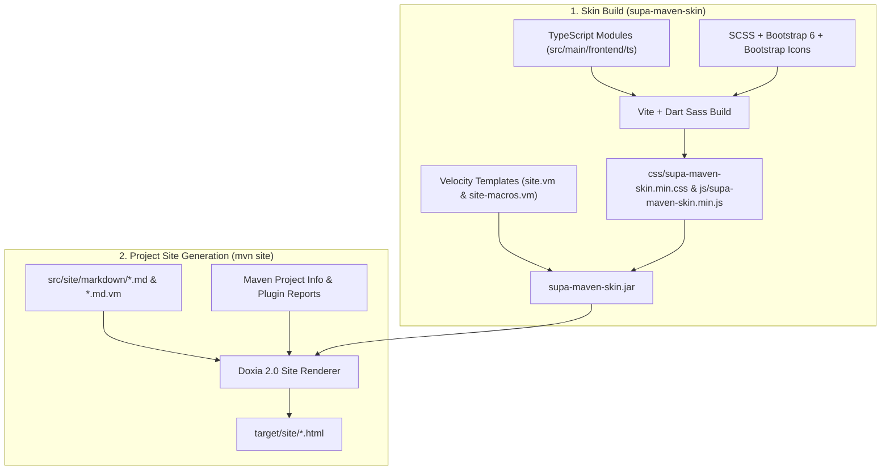

# Architecture & Color System

This page explains how **Supa Maven Skin** bridges Apache Maven's Doxia 2.0 rendering pipeline with **Bootstrap 6 (`6.0.0-alpha.1`)**, Sphinx Furo's 3-column information architecture, and **WCAG 2.2 AA & AAA** accessible color schemes.

---

## Build & Rendering Pipeline

When a Maven project runs `mvn site`, `maven-site-plugin` (`3.21.0+`) and `doxia-site-renderer` (`2.0+`) combine your Markdown/APT/XDoc content and Maven Reports with the skin's pre-bundled assets:

---

## Responsive 3-Column Furo Layout

Inspired by Pradyun Gedam's [Furo](https://pradyunsg.me/furo/) theme for Sphinx, `supa-maven-skin` organizes technical documentation into three distinct spatial zones that adapt across viewports using native HTML5 `<dialog>` drawers:

1. **Left Navigation Sidebar (`280px` on `lg+` / `1024px+`)**:
   - Displays the project brand, dual-theme logo (`<lightLogo>` / `<darkLogo>`), version badge, search trigger (`⌘K` / `/`), and hierarchical `
` / `
` navigation menus.
   - Below `1024px`, the same DOM node (`<dialog id="supaSidebarDrawer" class="lg:drawer drawer-start">`) acts as an accessible off-canvas Bootstrap 6 left drawer without duplicating navigation markup.
2. **Center Article Prose (`48rem` maximum reading measure)**:
   - Constrains line length to ~65–75 characters per line for comfortable technical reading while allowing tables and code blocks to scroll horizontally inside `.supa-table-responsive` and `.supa-code-block`.
3. **Right "On this page" Table of Contents (`240px` on `xl+` / `1280px+`)**:
   - Dynamically constructed at runtime from `h2`–`h4` headings inside `<main id="supa-main-content">` and bound to Bootstrap 6's `ScrollSpy` plugin.
   - Below `1280px`, `<dialog id="supaTocDrawer" class="xl:drawer drawer-end">` opens as a right-hand drawer from the top utility bar.

---

## Doxia 2.0 Normalization & `.prose` Isolation

Maven reports (such as `dependencies.html`, `ci-management.html`, `team.html`, and `plugin-info.html`) emit legacy Doxia HTML patterns (`<table class="bodyTable">`, `<h2>Section Name</h2>`, `<pre><a class="externalLink">`). At page load, `supa-maven-skin` normalizes these patterns so reports look indistinguishable from hand-authored Markdown pages:

- **Doxia Heading Anchor Reconciliation (`toc.ts`)**:
  - Doxia places `` immediately before or inside headings without setting an `id` on the `<h2>` element itself.
  - `prepareHeadings()` assigns clean URL-friendly slugs (`id="1-actions-buttons"`) while preserving the original Doxia `<a id="...">` anchor and recording `data-doxia-id`, ensuring both Doxia report links and clean Markdown `#slug` links scroll accurately.
- **Responsive Table Classification (`doxia.ts`)**:
  - `normalizeDoxiaTables()` upgrades `table.bodyTable` into `.table.table-hover` inside `.supa-table-responsive` and classifies columns into `.supa-table-col-compact` (single-line identifiers/defaults) vs. `.supa-table-col-prose` (multi-sentence descriptions) so inline `<code>` tokens never wrap mid-word.
- **`.prose` vs. `.not-prose` Isolation (`bootstrap-components.ts`)**:
  - Bootstrap 6's `.prose` class styles article paragraphs, lists, and tables. `isolateBootstrapComponentsFromProse()` automatically adds `.not-prose` to interactive Bootstrap 6 components (`.card`, `.alert`, `.accordion`, `.nav`, `.stepper`, `.chip-input`) so prose list/margin rules never collide with UI widgets.

---

## WCAG 2.2 AA & AAA Accessible Color System

`supa-maven-skin` ships with 6 color schemes across Light and Dark polarities (12 total theme surfaces), verified at build time by `scripts/lint-scss.mjs`:

| Tier | Palettes | Minimum Contrast Guarantees |
| :--- | :--- | :--- |
| **WCAG 2.2 AA** | `furo`, `bootstrap` | &ge; `4.5:1` for body and secondary text against both primary and secondary backgrounds; &ge; `3.0:1` for interactive UI borders. |
| **WCAG 2.2 AAA** | `modus`, `modus-tinted`, `modus-deuteranopia`, `modus-tritanopia` | &ge; `7.0:1` for body, secondary, muted, code, and admonition text against both primary and secondary backgrounds; colorblind-safe semantic palettes for deuteranopia and tritanopia. |

### Zero-FOUC Initialization

An inline script in `<head>` reads `localStorage.getItem('supa-theme')` (`light`, `dark`, `auto`) and `localStorage.getItem('supa-palette')` before first paint, setting `data-bs-theme`, `data-supa-resolved-theme`, and `data-supa-palette` on `<html>`. If the user has not chosen a palette and their OS reports `prefers-contrast: more`, the skin automatically escalates to the WCAG AAA `modus` palette.

---

## Zero-Config Client-Side Search

When `<search>true</search>` is active, pressing `/` or `⌘K` (`Ctrl+K`) opens `#supaSearchDialog`:

1. **Immediate Local Index**: On open, `collectLocalSearchDocuments()` immediately indexes all sidebar navigation links and the current page's `h1`–`h4` sections.
2. **Cross-Page & Report Indexing**: `fetchSiteIndex()` fetches sibling pages and Maven reports linked in the sidebar, extracts their page titles, `h1`–`h4` section anchors, and prose snippets, and caches the resulting index in `sessionStorage` (`supa-site-search-index-v2:<root>`) for instant subsequent queries during the browsing session.
