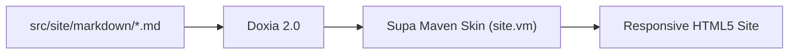

# Authoring Rich Content

This how-to guide provides copy-ready recipes for authoring documentation pages in **Supa Maven Skin** using standard Markdown (`.md`), embedded HTML, and Velocity-preprocessed Markdown (`.md.vm`).

---

## Choosing Markdown (`.md`) vs. Velocity Templates (`.md.vm`)

Doxia 2.0 supports two ways to author Markdown pages in `src/site/markdown/`:

| File Extension | Processing Pipeline | Best For |
| :--- | :--- | :--- |
| **`page.md`** | CommonMark &rarr; HTML + Furo DOM transforms | Fast, clean prose using `:bi-...:` icon shortcodes, `> [!NOTE]` admonitions, `.supa-tabs`, `.supa-accordion`, and embedded Bootstrap 6 HTML. |
| **`page.md.vm`** | Apache Velocity &rarr; CommonMark &rarr; HTML + Furo DOM transforms | Pages that need live Maven POM variables (`${project.version}`, `${project.groupId}`) or Velocity helper macros (`#bi`, `#bsAlert`, `#bsBadge`, `#bsCard`). |

### Rules for `.md.vm` Files and Embedded HTML

1. **Importing Skin Macros in `.md.vm`**:
   Add `#parse( "META-INF/maven/site-macros.vm" )` (or `#parse( "site-macros.vm" )` when resolved on the Velocity classpath) at the top of your `.md.vm` file to enable `#bi`, `#bsAlert`, `#bsBadge`, and `#bsCard`.
2. **Escaping `##` Headings in `.md.vm`**:
   Because `##` denotes a single-line comment in Apache Velocity, write level-2+ Markdown headings as `\## Section Heading` (or `<h2>Section Heading</h2>`) inside `.md.vm` files.
3. **Keeping Multi-Line HTML Blocks Contiguous**:
   In CommonMark (Doxia 2.0), a blank line inside a raw HTML `<div>...</div>` block ends the HTML block early. Keep multi-line HTML component wrappers free of internal empty lines.

---

## Writing Admonitions and Alerts

### Furo Admonitions (GFM Blockquote Syntax)

To create a Furo admonition card with a semantic icon, tinted header bar, and colored left accent border, start a Markdown blockquote with `[!NOTE]`, `[!TIP]`, `[!IMPORTANT]`, `[!WARNING]`, or `[!CAUTION]`. Any text after the tag on the first line becomes a custom title:

<div class="supa-component-preview">
  <blockquote>
    <p>[!NOTE]
    Admonitions automatically adapt to all 6 WCAG 2.2 AA &amp; AAA color schemes in Light and Dark modes.</p>
  </blockquote>
  <blockquote>
    <p>[!TIP] Custom Admonition Title
    Provide text immediately after <code>[!TIP]</code> on the first line to override the default heading.</p>
  </blockquote>
</div>

```markdown
> [!NOTE]
> Admonitions automatically adapt to all 6 WCAG 2.2 AA & AAA color schemes in Light and Dark modes.

> [!TIP] Custom Admonition Title
> Provide text immediately after `[!TIP]` on the first line to override the default heading.

> [!IMPORTANT]
> Highlights essential requirements or prerequisites.

> [!WARNING]
> Warns readers about potential configuration pitfalls.

> [!CAUTION]
> Alerts readers to destructive actions or breaking changes.
```

### Bootstrap 6 Semantic Alerts (`[!ALERT:...]` & `#bsAlert`)

When you need a Bootstrap 6 `.alert` banner (supporting all 8 `.theme-*` colors and optional dismiss buttons), you can use the GFM blockquote shorthand, raw HTML, or the `#bsAlert` Velocity macro:

<div class="supa-component-preview">
  <blockquote>
    <p>[!ALERT:primary dismissible] Release Ready
    Use <code>[!ALERT:theme dismissible]</code> in Markdown or <code>#bsAlert</code> in Velocity.</p>
  </blockquote>
</div>

<div class="supa-tabs" title="authoring-mode">
  <div title="Markdown Shorthand">
    <pre><code class="language-markdown">&gt; [!ALERT:primary dismissible] Release Ready
&gt; Use `[!ALERT:theme dismissible]` in Markdown or `#bsAlert` in Velocity.</code></pre>
  </div>
  <div title="Velocity Macro (.md.vm)">
    <pre><code class="language-velocity">#parse( "META-INF/maven/site-macros.vm" )
#bsAlert( "primary" "Release Ready" "Use <code>#bsAlert</code> in Velocity templates." true )</code></pre>
  </div>
  <div title="Markdown + HTML">
    <pre><code class="language-html">&lt;div class="alert theme-primary not-prose" role="alert"&gt;
  &lt;div class="flex-grow-1"&gt;
    &lt;div class="alert-heading fw-semibold mb-1"&gt;Release Ready&lt;/div&gt;
    &lt;div&gt;Standard Bootstrap 6 alert markup.&lt;/div&gt;
  &lt;/div&gt;
  &lt;button type="button" class="btn-close ms-auto" data-bs-dismiss="alert" aria-label="Close"&gt;&lt;/button&gt;
&lt;/div&gt;</code></pre>
  </div>
</div>

---

## Adding Bootstrap Icons

`supa-maven-skin` bundles **2,000+ [Bootstrap Icons](https://icons.getbootstrap.com/)** offline (`bootstrap-icons.woff2`). You can insert icons using Markdown shortcodes, the `#bi` Velocity macro, or HTML `<i>` tags.

<div class="supa-component-preview">
  <div class="d-flex flex-wrap align-items-center gap-3">
    <span class="d-inline-flex align-items-center gap-1 fw-medium">:bi-rocket-takeoff text-primary fs-5: Launch</span>
    <span class="d-inline-flex align-items-center gap-1 fw-medium">:bi-check-circle-fill text-success fs-5: Verified</span>
    <span class="d-inline-flex align-items-center gap-1 fw-medium">:bi-exclamation-triangle-fill text-warning fs-5: Warning</span>
    <span class="d-inline-flex align-items-center gap-1 fw-medium">:bi-github fs-5: GitHub</span>
  </div>
</div>

### 1. Markdown Shortcode (`:bi-<name>:`)

Write `:bi-<icon-name>:` anywhere in prose, table cells, headings, or lists. You can optionally append space-separated utility classes (such as `text-primary`, `text-success`, `fs-5`, `me-1`) before the closing colon:

```markdown
- :bi-rocket-takeoff: Basic decorative icon
- :bi-check-circle-fill text-success fs-5: Icon with color and font-size utilities
- :bi-github me-1: Icon with right margin inside a link
```

> [!NOTE] Code Block Safety
> Shortcodes inside inline `` `code` `` and `<pre><code>` blocks are automatically ignored and left untouched as literal text.

### 2. Velocity Macro (`#bi`)

In `.md.vm` pages, use `#bi( $name $extraClasses $ariaLabel )`. All arguments after `$name` are optional:

```velocity
#parse( "META-INF/maven/site-macros.vm" )

## 1 argument: decorative icon (renders aria-hidden="true")
#bi( "rocket-takeoff" ) Launch

## 2 arguments: icon + extra CSS utility classes (renders aria-hidden="true")
#bi( "check-circle-fill" "text-success fs-5" ) Verified

## 3 arguments: semantic accessible icon (renders role="img" aria-label="Accessible")
#bi( "universal-access-circle" "text-info fs-5" "Accessible" ) WCAG 2.2 AAA
```

### 3. Raw HTML (`<i class="bi bi-..."></i>`)

```html
<i class="bi bi-rocket-takeoff text-primary fs-5" aria-hidden="true"></i> Launch
```

---

## Creating Synchronized Content Tabs

Wrap child `<div title="Tab Label">` panels inside `<div class="supa-tabs" title="group-key">` to create ARIA-compliant tablists.

- **Synchronization**: Every `.supa-tabs` container sharing the same `title` (or `data-tab-group`) attribute automatically synchronizes across the page and persists the user's preferred tab in `localStorage` (`supa-tab-sync`).
- **Keyboard Navigation**: Supports `ArrowLeft`, `ArrowRight`, `Home`, and `End` keys out of the box.

<div class="supa-tabs" title="build-tool-demo">
  <div title="Maven (pom.xml)">
    <pre><code class="language-xml">&lt;dependency&gt;
  &lt;groupId&gt;io.github.mepcotterell&lt;/groupId&gt;
  &lt;artifactId&gt;supa-maven-skin&lt;/artifactId&gt;
  &lt;version&gt;0.1.0-SNAPSHOT&lt;/version&gt;
&lt;/dependency&gt;</code></pre>
  </div>
  <div title="Site Descriptor (site.xml)">
    <pre><code class="language-xml">&lt;skin&gt;
  &lt;groupId&gt;io.github.mepcotterell&lt;/groupId&gt;
  &lt;artifactId&gt;supa-maven-skin&lt;/artifactId&gt;
  &lt;version&gt;0.1.0-SNAPSHOT&lt;/version&gt;
&lt;/skin&gt;</code></pre>
  </div>
</div>

```html
<div class="supa-tabs" title="build-tool-demo">
  <div title="Maven (pom.xml)">
    <pre><code class="language-xml">&lt;dependency&gt;
  &lt;groupId&gt;io.github.mepcotterell&lt;/groupId&gt;
  &lt;artifactId&gt;supa-maven-skin&lt;/artifactId&gt;
  &lt;version&gt;0.1.0-SNAPSHOT&lt;/version&gt;
&lt;/dependency&gt;</code></pre>
  </div>
  <div title="Site Descriptor (site.xml)">
    <pre><code class="language-xml">&lt;skin&gt;
  &lt;groupId&gt;io.github.mepcotterell&lt;/groupId&gt;
  &lt;artifactId&gt;supa-maven-skin&lt;/artifactId&gt;
  &lt;version&gt;0.1.0-SNAPSHOT&lt;/version&gt;
&lt;/skin&gt;</code></pre>
  </div>
</div>
```

---

## Building Accordions and Steppers

### Declarative Accordions (`.supa-accordion`)

Wrap `<div title="Section Heading">` items inside `<div class="supa-accordion">`. Add `class="open"` to any item that should be expanded initially:

<div class="supa-component-preview">
  <div class="supa-accordion">
    <div title="How do I set a default color scheme?" class="open">
      <p>Set <code>&lt;colorScheme&gt;modus&lt;/colorScheme&gt;</code> inside <code>&lt;custom&gt;&lt;supaSkin&gt;</code> in your <code>src/site/site.xml</code>.</p>
    </div>
    <div title="Does Supa Maven Skin work offline?">
      <p>Yes. Bootstrap 6 CSS/JS, Bootstrap Icons fonts, and Highlight.js are all bundled directly inside the skin JAR.</p>
    </div>
  </div>
</div>

```html
<div class="supa-accordion">
  <div title="How do I set a default color scheme?" class="open">
    <p>Set <code>&lt;colorScheme&gt;modus&lt;/colorScheme&gt;</code> inside <code>&lt;custom&gt;&lt;supaSkin&gt;</code> in your <code>src/site/site.xml</code>.</p>
  </div>
  <div title="Does Supa Maven Skin work offline?">
    <p>Yes. Bootstrap 6 CSS/JS, Bootstrap Icons fonts, and Highlight.js are all bundled directly inside the skin JAR.</p>
  </div>
</div>
```

### Declarative Steppers (`ol.supa-stepper`)

Use `<ol class="supa-stepper" title="2">` where `title` specifies the 1-based active step index (all steps up to that number are styled as active/completed):

<div class="supa-component-preview">
  <ol class="supa-stepper" title="2">
    <li>Configure pom.xml</li>
    <li>Author Markdown</li>
    <li>Deploy Site</li>
  </ol>
</div>

```html
<ol class="supa-stepper" title="2">
  <li>Configure pom.xml</li>
  <li>Author Markdown</li>
  <li>Deploy Site</li>
</ol>
```

---

## Rendering Mermaid Diagrams and KaTeX Math

When `<mermaid>auto</mermaid>` and `<katex>auto</katex>` are enabled in `site.xml` (the default), `supa-maven-skin` inspects each page at load time and only fetches Mermaid or KaTeX when diagrams or math expressions are present on that page.

### Mermaid Diagrams

Use a standard fenced ```` ```mermaid ```` code block. The diagram automatically re-renders when the user toggles between Light and Dark themes:

````markdown

````

### KaTeX Mathematical Notation

Write inline math between single `$...$` delimiters (such as $O(n \log n)$) and display equations between `$$...$$` delimiters:

```markdown
Inline complexity $O(n \log n)$ or display block:

$$
\hat{y} = \sigma\left( \sum_{i=1}^{d} w_i x_i + b \right)
$$
```
