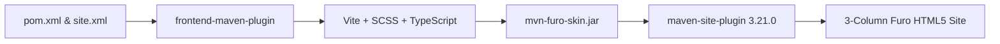

# Kitchen Sink Showcase

This page demonstrates all typography, Furo admonitions, syntax-highlighted code blocks, synchronized content tabs, responsive Doxia tables, Bootstrap 6 components, Mermaid diagrams, and KaTeX math provided by **Maven Furo Skin**.

## Furo Admonitions

GitHub-Flavored Markdown blockquote alerts are automatically transformed into Furo admonition cards with semantic icons, tinted headers, and colored left borders:

> [!NOTE]
> Useful information that users should know, even when skimming content. Furo admonitions adapt automatically between Light and Dark themes using CSS `light-dark()`.

> [!TIP] Pro Tip: Instant Keyboard Search
> Press <kbd>/</kbd> or <kbd>⌘K</kbd> (<kbd>Ctrl+K</kbd>) anywhere on the page to open the native `<dialog class="dialog">` search modal.

> [!IMPORTANT]
> Key information users need to know to achieve their goal, such as requiring `maven-site-plugin` `3.21.0+` (Doxia 2.0 / Doxia Sitetools 2.0).

> [!WARNING]
> Urgent information that needs immediate user attention to avoid subtle configuration issues.

> [!CAUTION]
> Advises about risks or negative outcomes of destructive operations.

## Syntax Highlighting & Copy Button

Code blocks display a subtle language badge (`JAVA`, `TS`, `DIFF`, `XML`) in the top-right corner that cross-fades into the **Copy to clipboard** button on hover.

### Synchronized Content Tabs (`sphinx-inline-tabs`)

Switch between tabs below—active tab selection is automatically persisted and synchronized across tab groups:

<div class="furo-tabs" title="jvm-lang" data-tab-group="jvm-lang">
  <div title="Java 21" data-tab="Java 21">
    <pre><code class="language-java">package dev.cotterell.maven.skins;
import java.util.List;
public record FuroSkinConfig(
    String defaultTheme,
    boolean tocSidebar,
    int tocMaxDepth,
    List&lt;String&gt; languages
) {
    public static FuroSkinConfig defaults() {
        return new FuroSkinConfig("auto", true, 4, List.of("java", "kotlin", "xml", "ts"));
    }
}</code></pre>
  </div>
  <div title="Kotlin" data-tab="Kotlin">
    <pre><code class="language-kotlin">package dev.cotterell.maven.skins
data class FuroSkinConfig(
    val defaultTheme: String = "auto",
    val tocSidebar: Boolean = true,
    val tocMaxDepth: Int = 4,
    val languages: List&lt;String&gt; = listOf("java", "kotlin", "xml", "ts")
)</code></pre>
  </div>
</div>

### TypeScript & Bootstrap 6 ESM Example

```typescript
import Dialog from 'bootstrap/js/dist/dialog.js';
import Drawer from 'bootstrap/js/dist/drawer.js';
import ScrollSpy from 'bootstrap/js/dist/scrollspy.js';

export function openSearchModal(dialogEl: HTMLDialogElement): void {
  const modal = Dialog.getOrCreateInstance(dialogEl);
  modal.show();
}
```

### Unified Diff Example

```diff
 <skin>
-  <groupId>org.apache.maven.skins</groupId>
-  <artifactId>maven-fluido-skin</artifactId>
-  <version>2.0.0-M11</version>
+  <groupId>dev.cotterell.maven.skins</groupId>
+  <artifactId>mvn-furo-skin</artifactId>
+  <version>0.1.0-SNAPSHOT</version>
 </skin>
```

## Responsive Doxia Tables

Standard Markdown and Doxia `table.bodyTable` elements are automatically normalized into responsive Bootstrap 6 tables:

| Component | Desktop (`xl+` / 1280px+) | Laptop (`lg` / 1024px–1279px) | Tablet & Mobile (`< 1024px`) |
| :--- | :--- | :--- | :--- |
| **Left Navigation Sidebar** | Sticky `280px` column | Sticky `280px` column | Off-canvas `<dialog class="lg:drawer drawer-start">` |
| **Center Prose Article** | Centered `48rem` max measure | Centered `48rem` max measure | Fluid width with responsive padding |
| **Right "On this page" TOC** | Sticky `240px` ScrollSpy column | Off-canvas `<dialog class="xl:drawer drawer-end">` | Off-canvas `<dialog class="xl:drawer drawer-end">` |
| **Documentation Search** | `<dialog class="dialog">` modal | `<dialog class="dialog">` modal | `<dialog class="dialog">` modal |

## Bootstrap 6 UI Components

Because `mvn-furo-skin` bundles **all 28 Bootstrap `6.0.0-alpha.1` component families and 20 interactive JS plugins**, you can use Bootstrap 6 buttons, badges, avatars, chips, accordions, steppers, menus, dialogs, drawers, comboboxes, datepickers, and cards directly in documentation pages:

<div class="not-prose my-4">
  <div class="d-flex flex-wrap gap-2 mb-3">
    <span class="badge theme-primary">Primary Badge</span>
    <span class="badge theme-secondary">Secondary Badge</span>
    <span class="badge theme-success">Success</span>
    <span class="badge theme-info">Info</span>
    <span class="badge theme-warning">Warning</span>
    <span class="badge theme-danger">Danger</span>
  </div>
  <div class="card p-3" style="background-color: var(--color-background-secondary); border-color: var(--color-background-border); border-radius: 0.5rem;">
    <div class="d-flex flex-wrap justify-content-between align-items-center gap-2">
      <div>
        <div class="fw-semibold mb-1">Full Bootstrap 6 Component Catalog</div>
        <p class="mb-0 text-secondary" style="font-size: 0.9rem;">Explore all 28 Bootstrap 6 component families, variants, and interactive JS widgets.</p>
      </div>
      <a href="bootstrap-components.html" class="btn btn-sm btn-solid theme-primary">Explore All 28 Components &rarr;</a>
    </div>
  </div>
</div>

### Collapsible Details Disclosure

<details class="mb-3">
  <summary class="fw-semibold" style="cursor: pointer;">Click to expand build pipeline details</summary>
  <p class="mt-2 mb-0">
    <code>frontend-maven-plugin</code> runs Vite and Dart Sass during the <code>generate-resources</code> phase, outputting <code>css/mvn-furo-skin.min.css</code> and <code>js/mvn-furo-skin.min.js</code> into <code>target/classes/</code>.
  </p>
</details>

## Diagrams & Mathematical Notation

### Mermaid Architecture Diagram

When a page contains a `mermaid` code block, `mvn-furo-skin` lazily loads Mermaid from CDN and renders it with matching Light/Dark theme variables:



### KaTeX Math Rendering

Inline math like $E = mc^2$ and display equations are automatically rendered when `<katex>auto</katex>` detects math delimiters:

$$
\mathcal{L}(\theta) = \frac{1}{N} \sum_{i=1}^{N} \left( y_i - f_\theta(x_i) \right)^2 + \lambda \|\theta\|_2^2
$$

## Typography & Prose Elements

### Inline Formatting, Blockquotes & Lists

> "Documentation should be effortless to read, navigate, and maintain—in both light and dark environments."

- **Bold text**, *italicized text*, ~~strikethrough~~, and `inline code` tokens.
- Keyboard shortcuts: <kbd>⌘</kbd> + <kbd>K</kbd>, <kbd>/</kbd>, and <kbd>Esc</kbd>.
- Automatic heading permalinks (`#`) on `h2` through `h4` headings:
  1. First ordered item
  2. Second ordered item with nested bullets:
     - Sub-item A (`--color-brand-primary`)
     - Sub-item B (`--color-brand-content`)

### Definition Lists

<dl>
  <dt>Doxia Sitetools 2.0</dt>
  <dd>The Apache Maven site rendering engine that processes Velocity templates and Markdown/APT/XDoc content.</dd>
  <dt>Bootstrap 6 (6.0.0-alpha.1)</dt>
  <dd>Next-generation Bootstrap featuring native HTML5 <code>&lt;dialog&gt;</code> modals and drawers, <code>.prose</code> typography, and <code>light-dark()</code> CSS tokens.</dd>
</dl>
